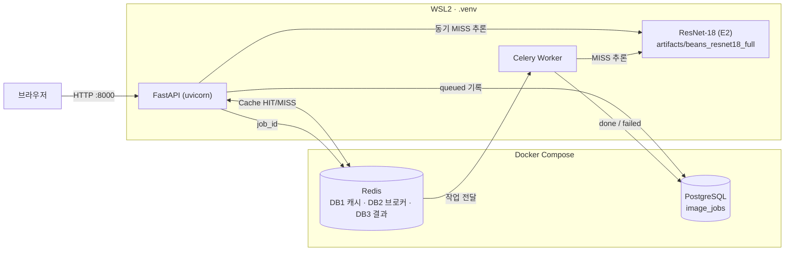

# 콩잎 질병 분류 ResNet-18 · FastAPI 동기·비동기 서빙

KH정보교육원 교과 9 평가과제입니다. 콩잎 사진 한 장을 `angular_leaf_spot`(각진잎반점병) · `bean_rust`(녹병) · `healthy`(정상) 중 하나로 분류하는 서비스를 실행하고, 학습 결과와 시스템 동작을 산출물 8종으로 정리합니다.

> **진행 상태 (2026-11-04)** — 데이터 배치, Head-only 학습(필수), 평가 가이드 방식 서비스 실행·실측·기능 테스트, 개선 실험(E1·E2), 최종 모델 Test 1회 평가 완료.

## 1. 환경

| 항목 | 내용 |
|---|---|
| OS | Windows 11 + WSL2 Ubuntu |
| Python | 프로젝트 전용 가상환경 `.venv` (Python 3.11) |
| Docker | Docker Desktop / Compose — **Redis 6379, PostgreSQL 5432만** 컨테이너로 실행 |
| Python 프로세스 | FastAPI(uvicorn), Celery Worker — `.venv`에서 각각 별도 터미널 |
| 모델 | [`microsoft/resnet-18`](https://huggingface.co/microsoft/resnet-18) → 3클래스 출력층으로 교체, Head-only Fine-tuning |
| 데이터 | [AI-Lab-Makerere/beans](https://huggingface.co/datasets/AI-Lab-Makerere/beans) `train` / `validation` / `test` |



## 2. 가상환경

```bash
cd ~/kh-subject9-eval-beans
uv venv --python 3.11 .venv          # 또는 python3.11 -m venv .venv
source .venv/bin/activate
uv pip install -r requirements.txt   # 또는 pip install -r requirements.txt
```

## 3. 데이터 준비

```bash
python scripts/prepare_data.py --download
```

Hugging Face의 `data/train.zip` · `validation.zip` · `test.zip`을 `beans_source/zips/`에 받아 원본을 `beans_source/`에 보존하고, 제공 코드가 읽는 `dataset/`에 배치합니다. **원본 `validation` → `dataset/val`** (제공 학습 코드가 `val`을 읽음). `test`는 학습·모델 선택·시연에 쓰지 않습니다. 클래스별 장수와 중복 검사 결과는 `reports/data/dataset_check.json`.

```text
dataset/
├── train/{angular_leaf_spot,bean_rust,healthy}/   1,034장
├── val/{angular_leaf_spot,bean_rust,healthy}/       133장  ← 원본 validation
└── test/{angular_leaf_spot,bean_rust,healthy}/      128장
```

## 4. 학습·평가

```bash
python -m training.finetune --data dataset --output artifacts/beans_resnet18 --epochs 3 --batch-size 8 --freeze-backbone
python -m training.evaluate --model artifacts/beans_resnet18 --split val
```

개선 실험 (제공 코드 수정 없이 실행 옵션만):

```bash
python -m training.finetune --data dataset --output artifacts/beans_resnet18_head10 --epochs 10 --batch-size 8 --freeze-backbone   # E1
python -m training.finetune --data dataset --output artifacts/beans_resnet18_full --epochs 5 --batch-size 8 --lr 0.00005           # E2 Full Fine-tuning
```

- 학습은 제공 코드 그대로 (Head-only, 필수). 결과: `config.json`, `model.safetensors`, `preprocessor_config.json`, `training_report.json`
- `training/evaluate.py`는 **추가 스크립트**로, 클래스별 Precision·Recall·혼동행렬을 계산합니다. Test는 최종 모델을 Val로 고른 뒤 `--split test --final`로 한 번만 쓰며, 실행 기록이 `reports/data/test_runs.log`에 남습니다.

## 5. 구동 순서 (평가 가이드 방식)

```bash
cp .env.example .env                                   # 기본값 MODEL_PATH=artifacts/beans_resnet18 (E0)
sed -i 's#^MODEL_PATH=.*#MODEL_PATH=artifacts/beans_resnet18_full#' .env  # 서비스는 최종 선정 E2
docker compose up -d redis postgres                    # Redis·PostgreSQL만
docker compose exec redis redis-cli ping               # PONG
```

터미널 1 (Worker):

```bash
source .venv/bin/activate
celery -A ai.celery_app:celery_app worker --loglevel=info --pool=solo --concurrency=1
```

터미널 2 (FastAPI):

```bash
source .venv/bin/activate
uvicorn main:app --host 127.0.0.1 --port 8000
```

| 주소 | 역할 |
|---|---|
| http://127.0.0.1:8000/vision/sync/ | 동기 분류 화면 |
| http://127.0.0.1:8000/vision/async/ | 비동기 분류 화면 |
| http://127.0.0.1:8000/docs | Swagger API 문서 |

- `compose.yaml`에는 제공 문서 02의 `web`·`worker`·`trainer` 서비스도 있지만, 평가 가이드 구조에 맞춰 **`redis postgres`만 띄웁니다.** 02 방식(전부 Docker)으로도 실행해 본 기록은 [docker_mode_02](reports/evidence/docker_mode_02/)에 따로 보관했습니다.
- 모델 경로를 바꾸면 FastAPI와 Worker를 모두 재시작합니다. `docker compose down -v`는 DB·Redis 볼륨을 지우므로 쓰지 않습니다.

## 6. 확인할 응답

- `GET /health` → `{"status":"ok"}`
- `POST /api/sync/classify/` → 200, `top1`, `all`, `inference_ms`, `cache_hit`
- `POST /api/async/classify/` → **202**(접수), `job_id`, `check_url` → `GET /api/async/jobs/{job_id}/` → `status=done`
- PostgreSQL `image_jobs` 조회 SQL: [산출물 4](reports/04_DB_구조_작업이력.md)
- 모의 테스트: `python -m pytest -q tests/test_api.py` (가짜 모델·SQLite, 실환경 검증 아님). 제공 문서의 `pytest -q …`는 `No module named 'ai'`로 실패 — [E-02](reports/07_기능테스트_오류분석.md)

## 7. 측정·캡처 스크립트 (추가)

| 스크립트 | 내용 |
|---|---|
| `scripts/prepare_data.py` | 데이터 다운로드·원본 보존·`dataset/` 배치·장수·SHA-256 중복 검사 |
| `scripts/bench_api.py` | 서비스 실행 중 Val 이미지로 동기·비동기 × MISS·HIT 측정, 오류 입력 → `reports/data/timings.csv`, `reports/evidence/api_responses.json` |
| `scripts/capture_ui.py` | 헤드리스 Chrome(Playwright)으로 화면에서 실제 업로드·버튼 클릭 후 캡처. `pip install playwright` 별도 필요 |

## 8. 결과 요약

| 항목 | 결과 |
|---|---|
| Train / Validation / Test | 1,034 / 133 / 128 (SHA-256 중복 0) |
| Head-only Best Validation Accuracy (3 Epoch) | 0.7669 — Macro F1 0.764, 가장 약한 클래스 bean_rust Recall 0.6444 |
| 개선 실험 Val Accuracy | E1 Head-only 10 Epoch 0.8947 / **E2 Full Fine-tuning 0.985** (최종 선정) |
| Test Accuracy (선정 후 1회) | E0 0.7188 → **E2 0.9766** (125/128) |
| 동기 MISS HTTP 완료 (중앙값 5회) | 22.0 ms (추론 17.0 ms) |
| 동기 HIT HTTP 완료 | 1.4 ms |
| 비동기 MISS HTTP 접수 | 10.6 ms |
| 비동기 MISS 최종 확인 (0.1초 조회) | 117.8 ms |
| 기능 테스트 (실환경) | 18개 PASS (Redis 장애 503·작업 실패 failed 포함) |

## 9. 산출물

| 번호 | 문서 |
|---|---|
| 1 | [Fine-tuning 결과보고서](reports/01_FineTuning_결과보고서.md) |
| 2 | [시스템 아키텍처](reports/02_시스템_아키텍처.md) |
| 3 | [API 명세서](reports/03_API_명세서.md) |
| 4 | [DB 구조·작업이력](reports/04_DB_구조_작업이력.md) |
| 5 | [AI 버튼 처리흐름](reports/05_AI버튼_처리흐름.md) |
| 6 | [성능비교 보고서](reports/06_성능비교_보고서.md) · 원본 [timings.csv](reports/data/timings.csv) |
| 7 | [기능테스트·오류분석](reports/07_기능테스트_오류분석.md) |
| 8 | [최종 기술보고서](reports/08_최종기술보고서.md) |

증빙 `reports/evidence/`, 도표 `reports/figures/`, 측정 원본 `reports/data/`.

## 10. 코드 출처

`ai/`, `training/finetune.py`, `templates/`, `static/`, `main.py`, `tests/test_api.py`, `requirements.txt`, `compose.yaml`, `Dockerfile`, `.dockerignore`, `.env.example`, `.gitignore`는 평가 자료 01·02의 제공 코드를 그대로 옮겼습니다 (02가 같은 파일을 교체하라고 한 곳은 02 버전, 01 단독용 루트 `test_api.py`는 02 지시에 따라 `tests/test_api.py`로 대체). `.gitignore`에는 `beans_source/` 한 줄만 추가했습니다.

**이 저장소에서 추가한 것** (제공 코드 아님): `training/evaluate.py`, `scripts/` 3개, `reports/`.

## 11. Git에 올리지 않는 것

`.venv/`, `.env`, `dataset/`, `beans_source/`, `artifacts/` 안의 모델, `media/jobs/` 안의 업로드 파일. `compose.yaml`의 DB 비밀번호는 로컬 실습용 기본값입니다. 데이터는 3절 스크립트로 Hugging Face에서 받습니다.

## 발표

- 3분 설명 대본·시연 순서·예상 질문: [presentation/발표_3분_질의응답.md](presentation/발표_3분_질의응답.md)
- 개선 실험(CNN + OpenCV 규칙 후처리): [산출물 1 §6-3](reports/01_FineTuning_결과보고서.md), 코드 `scripts/review_rule.py` (분석용 `requirements-analysis.txt`)
