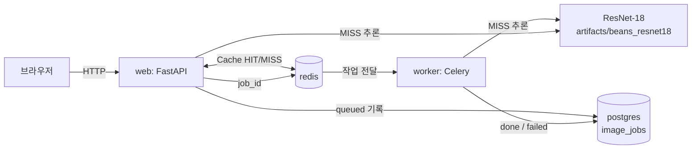

# 콩잎 질병 분류 ResNet-18 · FastAPI 동기·비동기 서빙

KH정보교육원 교과 9 평가과제입니다. 콩잎 사진 한 장을 올리면 `angular_leaf_spot`(각진잎반점병) · `bean_rust`(녹병) · `healthy`(정상) 중 하나로 분류하는 웹 서비스를 실행하고, 학습 결과와 시스템 동작을 산출물 8종으로 정리합니다.

> **진행 상태:** 데이터 배치, Head-only 학습, Docker 서비스 실행·실측·기능 테스트 완료 (2026-11-04). Test Accuracy는 아직입니다.

## 1. 구성

| 항목 | 내용 |
|---|---|
| 모델 | [`microsoft/resnet-18`](https://huggingface.co/microsoft/resnet-18) (ImageNet 1,000클래스) → 3클래스 출력층으로 교체 |
| 학습 방식 | Head-only Fine-tuning (`--freeze-backbone`, Backbone 고정) |
| 데이터 | [AI-Lab-Makerere/beans](https://huggingface.co/datasets/AI-Lab-Makerere/beans) `train` / `validation` / `test` |
| 학습 결과 | `artifacts/beans_resnet18/` (Git 제외) |
| 서빙 | FastAPI 동기 API + Celery 비동기 작업 |
| 저장소 | Redis (DB 1 캐시, DB 2 브로커, DB 3 결과) · PostgreSQL `image_jobs` |
| 실행 | Docker Compose 한 번으로 `web` · `worker` · `redis` · `postgres` 기동 |



## 2. 데이터 준비

Hugging Face [데이터 파일 목록](https://huggingface.co/datasets/AI-Lab-Makerere/beans/tree/main/data)에서 `train.zip` · `validation.zip` · `test.zip`을 받아 아래처럼 배치합니다. **원본 `validation`은 `dataset/val/`에 넣습니다** (제공 학습 코드가 `val`을 읽음). `test`는 학습에 쓰지 않습니다.

```text
dataset/
├── train/{angular_leaf_spot,bean_rust,healthy}/
├── val/{angular_leaf_spot,bean_rust,healthy}/     ← 원본 validation
└── test/{angular_leaf_spot,bean_rust,healthy}/
```

## 3. 학습 (Head-only, 필수)

```bash
python -m training.finetune --data dataset --output artifacts/beans_resnet18 --epochs 3 --batch-size 8 --freeze-backbone
```

로컬 `.venv`가 없으면 Docker로도 학습할 수 있습니다: `docker compose run --rm trainer`

결과 파일: `config.json`, `model.safetensors`, `preprocessor_config.json`, `training_report.json`

## 4. 실행

```bash
mkdir -p artifacts media/jobs
cp .env.example .env              # MODEL_PATH=artifacts/beans_resnet18
docker compose up -d --build
docker compose ps
curl http://127.0.0.1:8000/health
```

| 주소 | 역할 |
|---|---|
| http://127.0.0.1:8000/vision/sync/ | 동기 분류 화면 |
| http://127.0.0.1:8000/vision/async/ | 비동기 분류 화면 |
| http://127.0.0.1:8000/docs | Swagger API 문서 |

모델 경로를 바꾼 뒤에는 `docker compose up -d --force-recreate web worker`. `docker compose down -v`는 DB·Redis 볼륨을 지우므로 쓰지 않습니다.

## 5. 확인할 응답

- `GET /health` → `{"status":"ok"}`
- `POST /api/sync/classify/` → 200, `top1`, `all`, `inference_ms`, `cache_hit`
- `POST /api/async/classify/` → 202, `job_id`, `check_url` / `GET /api/async/jobs/{job_id}/` → `status=done`
- PostgreSQL 기록: [산출물 4](reports/04_DB_구조_작업이력.md)의 조회 SQL
- 모의 테스트: `docker compose exec web python -m pytest -q tests/test_api.py` (실제 모델·Redis·Celery 동작은 검증하지 않음). 문서의 `pytest -q …`는 `No module named 'ai'`로 실패 — [E-02](reports/07_기능테스트_오류분석.md)

## 6. 결과 요약

| 항목 | 결과 |
|---|---|
| Train / Validation / Test 이미지 수 | 1,034 / 133 / 128 |
| Best Validation Accuracy (Head-only, 3 Epoch) | 0.7669 |
| Test Accuracy | 미측정 (제공 코드에 Test 평가 없음) |
| 동기 MISS HTTP 완료 (중앙값 5회) | 20.4 ms (추론 14.7 ms) |
| 동기 HIT HTTP 완료 (중앙값 5회) | 1.9 ms |
| 비동기 MISS HTTP 접수 (중앙값 5회) | 9.9 ms |
| 비동기 MISS 최종 확인 (중앙값 5회, 0.1초 조회) | 120.7 ms |
| 기능 테스트 (실환경) | 15개 PASS (화면 버튼 2개 포함), 2개 미실시 |

측정 환경: Docker Desktop + WSL2, i7-12700, 서비스는 CPU 추론. 첫 요청(모델 로딩 약 2.3초)은 제외.

## 7. 산출물

| 번호 | 문서 |
|---|---|
| 1 | [Fine-tuning 결과보고서](reports/01_FineTuning_결과보고서.md) |
| 2 | [시스템 아키텍처](reports/02_시스템_아키텍처.md) |
| 3 | [API 명세서](reports/03_API_명세서.md) |
| 4 | [DB 구조·작업이력](reports/04_DB_구조_작업이력.md) |
| 5 | [AI 버튼 처리흐름](reports/05_AI버튼_처리흐름.md) |
| 6 | [성능비교 보고서](reports/06_성능비교_보고서.md) · 원본 `reports/data/timings.csv` |
| 7 | [기능테스트·오류분석](reports/07_기능테스트_오류분석.md) |
| 8 | [최종 기술보고서](reports/08_최종기술보고서.md) |

캡처는 `reports/evidence/`, 도표는 `reports/figures/`, 측정 원본은 `reports/data/`에 둡니다.

## 8. 제공 코드 출처

평가 자료 `01_Image_Classification_ResNet18_FastAPI_FineTuning`, `02_FastAPI_ResNet18_Redis_Celery_동기비동기`의 코드를 그대로 옮겼습니다 (02가 같은 파일을 교체하라고 한 곳은 02 버전). 01 단독용 루트 `test_api.py`는 02 지시에 따라 `tests/test_api.py`로 대체했습니다.

수업 실습 버전([kh-vision-ai · fastapi_resnet18](https://github.com/wlgptjd333/kh-vision-ai/tree/main/subject09_machinevision/fastapi_resnet18))과 비교하면 `ai/`·`templates/`·`static/`·`main.py`·`requirements.txt`는 같고, 달라진 점은 다음과 같습니다.

| 파일 | 변경 |
|---|---|
| `Dockerfile`, `.dockerignore` | 새로 추가 (CPU용 PyTorch 2.5.1) |
| `compose.yaml` | Redis·PostgreSQL에 `web`·`worker`·`trainer` 서비스 추가 |
| `.env.example` | `MODEL_PATH=artifacts/beans_resnet18` (옛 `cap_quality` 예시 제거) |
| `training/finetune.py` | 학습 로직 동일, 기본 출력 경로와 줄바꿈만 다름 |
| `tests/test_api.py` | 가짜 라벨을 콩잎 클래스명으로 변경 |

## 9. Git에 올리지 않는 것

`.env`, `dataset/`, `artifacts/` 안의 모델, `media/jobs/` 안의 업로드 파일. `compose.yaml`의 DB 비밀번호는 로컬 Docker 실습용 기본값입니다. 데이터셋은 Hugging Face 링크에서 받습니다.
