<div align="center">

# 🌱 콩잎 질병 분류 Vision AI 서비스

**ResNet-18 Fine-tuning · FastAPI 동기 API · Celery 비동기 작업 · Redis · PostgreSQL**

콩잎 사진 한 장을 **각진잎반점병 · 녹병 · 정상** 중 하나로 판정하는 서비스입니다.<br/>
KH정보교육원 교과 9 평가과제


<br/>

| 🎯 Test 정확도 | 📈 개선 폭 | 🦠 녹병 재현율 (Val) | ⚡ 동기 응답 | ✅ 기능 테스트 |
|:---:|:---:|:---:|:---:|:---:|
| **0.72 → 0.98**<br/><sub>125 / 128장</sub> | **+25.78%p**<br/><sub>Head-only → Full</sub> | **0.64 → 0.96**<br/><sub>29 → 43 / 45장</sub> | **22 ms**<br/><sub>캐시 HIT 1.4 ms</sub> | **18 / 18**<br/><sub>실환경 PASS</sub> |

</div>

<br/>

**발표 흐름** &nbsp;·&nbsp; [① 무엇을 만들었나](#-무엇을-만들었나) → [② 성능과 개선](#-성능과-개선) → [③ 서비스 성능](#-서비스-성능) → [④ 검증과 한계](#-검증과-한계) → [📂 산출물](#-산출물-8종)

---

## ① 무엇을 만들었나

### 모델 — 사전학습 ResNet-18의 출력층만 3클래스로 교체

ImageNet(약 128만 장, 1,000클래스)으로 학습된 [`microsoft/resnet-18`](https://huggingface.co/microsoft/resnet-18)을 가져와, 마지막 층 `Linear(512→1000)`을 떼고 **`Linear(512→3)`** 을 새로 붙인 뒤 콩잎 사진으로 미세조정했습니다.

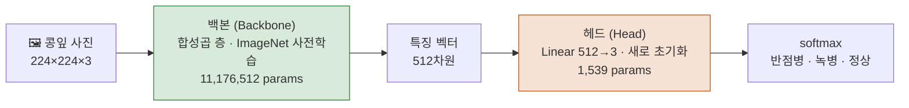

| 데이터 ([beans](https://huggingface.co/datasets/AI-Lab-Makerere/beans)) | Train | Validation | Test |
|---|:---:|:---:|:---:|
| 장수 (클래스 3개 균형) | 1,034 | 133 | 128 |
| 용도 | 학습 | 모델 선택 | **선정 후 1회만** |

### 서비스 — 같은 판정 함수를 두 경로로

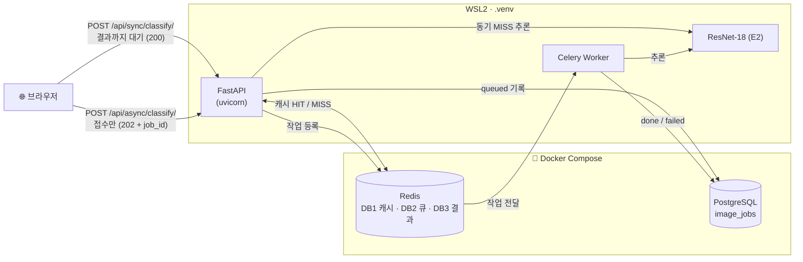

- **동기**: 판정이 끝날 때까지 기다렸다가 결과를 돌려줌. Redis 캐시만 사용
- **비동기**: 사진 저장 → DB에 `queued` → Redis 큐 → Worker가 판정 → DB에 `done`. 화면은 `job_id`로 상태 조회
- 판정은 `ai/services.py` 하나에 모아 FastAPI와 Worker가 **같은 함수**(`classify_with_cache`)를 씀

<table>
<tr>
<td width="50%" align="center">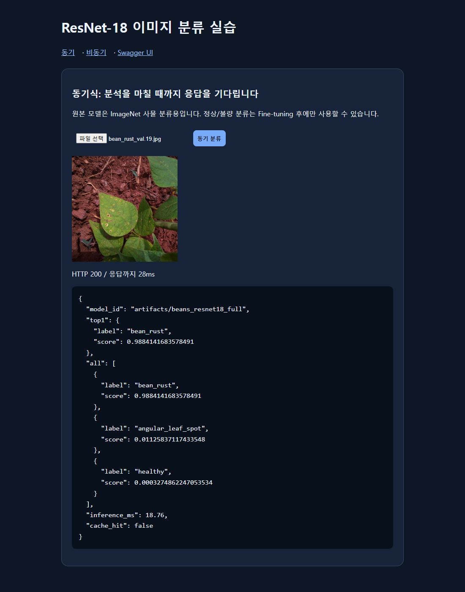<br/><sub>동기 화면 — 결과 즉시, <code>cache_hit: false</code></sub></td>
<td width="50%" align="center">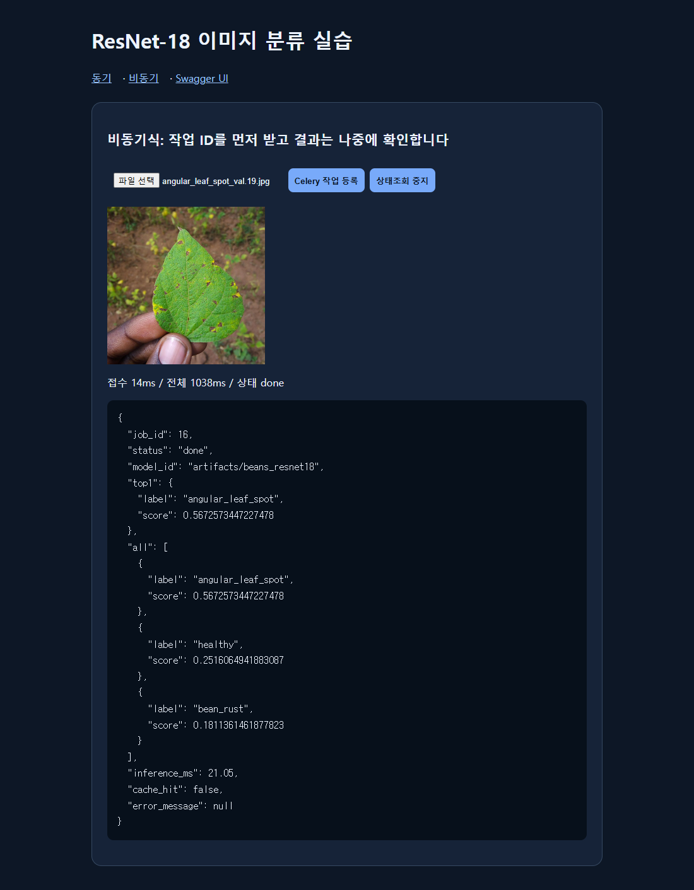<br/><sub>비동기 화면 — 202 접수 후 <code>done</code></sub></td>
</tr>
</table>

---

## ② 성능과 개선

> [!IMPORTANT]
> 제공 코드는 고치지 않고 **실행 옵션만** 바꿨습니다. 모델은 **Validation으로만** 골랐고, 선정 기록을 커밋한 뒤 Test를 한 번 봤습니다 (`reports/data/test_runs.log`).

| 실험 | 학습 범위 | 설정 | Val 정확도 | Test 정확도 |
|---|---|---|:---:|:---:|
| **E0** 기준선 (필수) | 헤드만 (백본 동결) | 3 Epoch, lr 2e-4 | 0.7669 | 0.7188 |
| **E1** | 헤드만 (백본 동결) | 10 Epoch | 0.8947 | — |
| **E2** ✅ 최종 | **백본 + 헤드 전체** | 5 Epoch, lr **5e-5** | **0.9850** | **0.9766** |

<p align="center">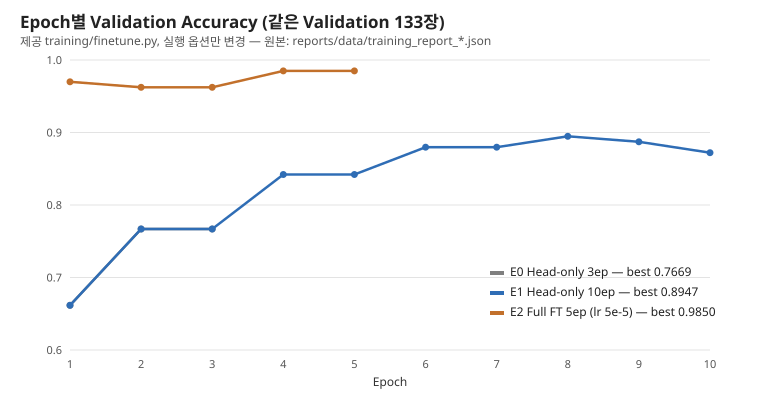</p>

**왜 Full이 좋아졌나** — Head-only는 백본이 고정돼 같은 사진에서 늘 같은 특징이 나오고, ImageNet용 특징으로는 **녹병이 잘 갈리지 않았습니다** (E0: 녹병 45장 중 16장을 반점병 8 · 정상 8로 오판). Full은 백본 가중치까지 낮은 학습률로 조정해 특징 자체가 콩잎 병반에 맞춰졌습니다.

| 클래스별 Recall (Val) | E0 | E1 | E2 |
|---|:---:|:---:|:---:|
| 반점병 angular_leaf_spot | 0.75 | 0.8864 | **1.0** |
| **녹병 bean_rust** | 0.6444 | 0.8667 | **0.9556** |
| 정상 healthy | 0.9091 | 0.9318 | **1.0** |

<sub>병든 잎을 정상으로 놓친 경우 11장 → 1장. Test에서 E2가 틀린 3장은 모두 녹병 (초기의 작고 옅은 반점)</sub>

### 교과 9 OpenCV 규칙 결합 실험

| 실험 | 방법 | 결과 |
|---|---|---|
| HSV 병반 면적비 | 초록 범위 밖 픽셀 비율, 기준 = Train 정상 잎 상위 5% (0.1006) | ❌ 병든 잎 중 4.8%만 기준을 넘음 — 구분 안 됨 (음성 결과) |
| **확신도 보류 규칙** | E2 점수 **< 0.9** 이면 "사람 확인 필요" | ✅ Test **14.1% 보류**, 오답 3장 중 2장 걸러냄, 나머지 **99.1%** 정확 |

> [!NOTE]
> 보류 규칙은 라벨을 바꾸지 않고 확인할 사진만 표시합니다. 모델 정확도(0.9766)와 규칙 성능을 따로 보고했으며, 서비스 API에는 넣지 않았습니다 (미구현 제안: `review_required` 필드, Grad-CAM, ROI 분할 — [산출물 8](reports/08_최종기술보고서.md)).

---

## ③ 서비스 성능

같은 Validation 사진으로 조건마다 5회 측정한 **중앙값** (E2 모델, CPU 추론)

| 경로 | 첫 요청 (MISS) | 같은 사진 다시 (HIT) |
|---|:---:|:---:|
| **동기** HTTP 응답 | **22.0 ms** (추론 17.0 ms) | **1.4 ms** (`inference_ms: null` = 추론 안 함) |
| **비동기** 접수 응답 (202) | **10.6 ms** | — |
| **비동기** 결과 확인 (`done`) | 117.8 ms (0.1초 간격 조회) | — |

<p align="center">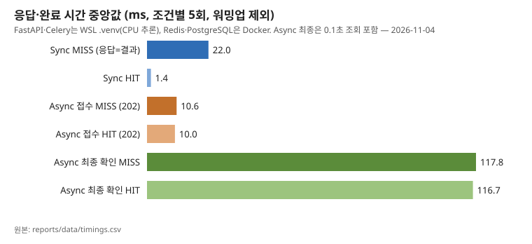</p>

### 사진 10장을 한꺼번에 보냈을 때

| 조건 (ms, 3회 중앙값) | 10장 모두 응답 | 10장 모두 결과 |
|---|:---:|:---:|
| 연속 · 동기 | 407.1 | 407.1 |
| 연속 · 비동기 | **103.9** (접수) | 370.1 |
| 동시 · 동기 | 144.0 | 144.0 |
| 동시 · 비동기 | 75.3 (접수) | 485.8 |

> [!NOTE]
> **비동기는 모델을 빠르게 하지 않습니다.** 접수와 처리를 나눠 웹 서버를 빨리 풀어 줄 뿐이고, 이 설정(Worker 1개)에서는 최종 결과 시간이 비슷하거나 늦습니다. 동시 요청에서 동기가 빨랐던 건 FastAPI 스레드풀이 여러 요청을 같이 처리한 반면 Worker는 1개였기 때문입니다.

---

## ④ 검증과 한계

**실환경 기능 테스트 18개 PASS** — [산출물 7](reports/07_기능테스트_오류분석.md)

| 상황 | 동작 |
|---|---|
| Worker 꺼짐 | 작업이 `queued`로 큐에 남음 → 다시 켜면 처리 |
| Redis 꺼짐 | 동기는 캐시 없이 정상 응답 / 비동기는 **503** + DB에 `failed` |
| 처리 중 파일 없음 | `failed` + 오류 메시지 기록 |
| 잘못된 파일 · 5MB 초과 | 400 / 413 |

**한계**
- 실험마다 학습 1회 (시드·반복 분산 미측정)
- Test 128장 — 1장이 0.78%p
- Worker 수를 늘린 부하 시험은 하지 않음

<details>
<summary><b>📸 실행 캡처 23장 보기</b></summary>
<br/>

| | |
|:---:|:---:|
| 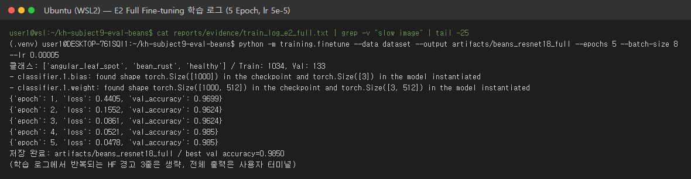<br/><sub>E2 학습 로그</sub> | 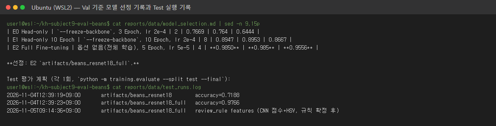<br/><sub>Test 1회 평가</sub> |
| 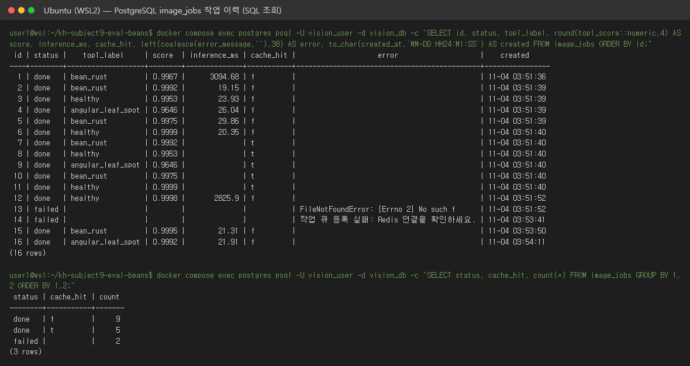<br/><sub>image_jobs 행</sub> | 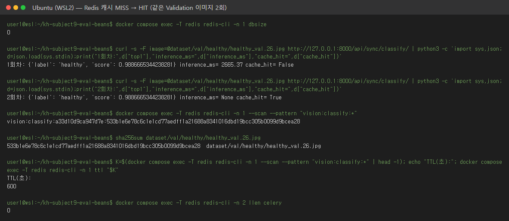<br/><sub>Redis 캐시 키</sub> |
| 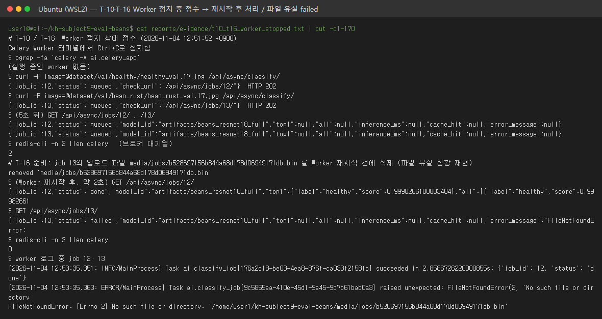<br/><sub>Worker 정지 시</sub> | 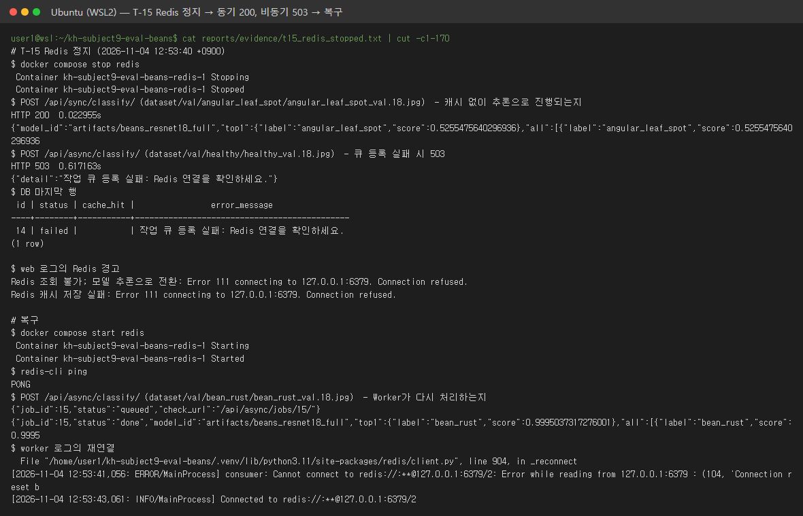<br/><sub>Redis 정지 시</sub> |
| 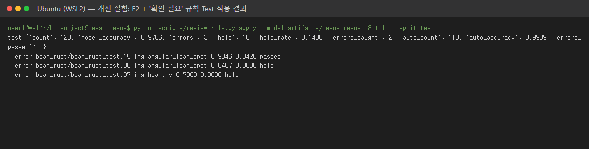<br/><sub>보류 규칙 결과</sub> | 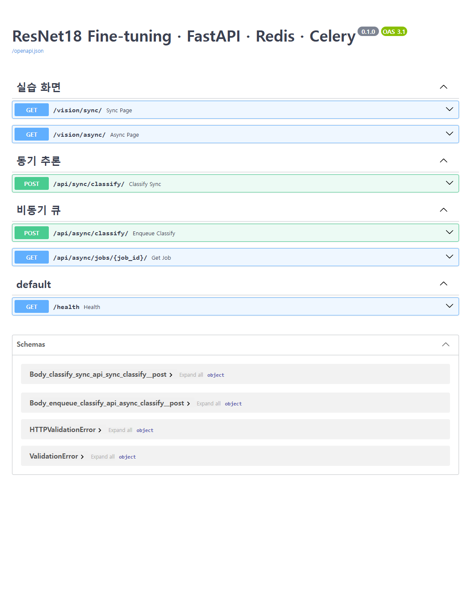<br/><sub>Swagger API 문서</sub> |

전체 목록: [`reports/evidence/screens/`](reports/evidence/screens/)

</details>

---

## 📂 산출물 8종

| # | 문서 | 내용 |
|:---:|---|---|
| 1 | [Fine-tuning 결과보고서](reports/01_FineTuning_결과보고서.md) | 데이터, E0·E1·E2, 혼동행렬, 규칙 실험 |
| 2 | [시스템 아키텍처](reports/02_시스템_아키텍처.md) | 구성요소, 프로세스, Docker 방식 비교 |
| 3 | [API 명세서](reports/03_API_명세서.md) | 엔드포인트, 요청·응답, 오류 코드 |
| 4 | [DB 구조·작업이력](reports/04_DB_구조_작업이력.md) | `image_jobs` 스키마, 상태 흐름, 조회 SQL |
| 5 | [AI 버튼 처리흐름](reports/05_AI버튼_처리흐름.md) | 버튼 클릭부터 결과까지 단계별 |
| 6 | [성능비교 보고서](reports/06_성능비교_보고서.md) | 동기·비동기 × MISS·HIT, 10장 실험 |
| 7 | [기능테스트·오류분석](reports/07_기능테스트_오류분석.md) | T-01~T-18, 오류 E-01~E-06 |
| 8 | [최종 기술보고서](reports/08_최종기술보고서.md) | 종합, 개선 제안 (구현 / 미구현 표시) |

<sub>증빙 `reports/evidence/` · 도표 `reports/figures/` · 측정 원본 `reports/data/`</sub>

---

<details>
<summary><b>🛠️ 실행 방법 (환경 · 데이터 · 학습 · 구동)</b></summary>

### 환경

| 항목 | 내용 |
|---|---|
| OS | Windows 11 + WSL2 Ubuntu |
| Python | 프로젝트 전용 `.venv` (Python 3.11) |
| Docker | Docker Desktop / Compose — **Redis 6379, PostgreSQL 5432만** 컨테이너 |
| Python 프로세스 | FastAPI(uvicorn), Celery Worker — `.venv`에서 각각 별도 터미널 |

```bash
cd ~/kh-subject9-eval-beans
uv venv --python 3.11 .venv          # 또는 python3.11 -m venv .venv
source .venv/bin/activate
uv pip install -r requirements.txt   # 규칙 실험은 requirements-analysis.txt(OpenCV)도
```

### 데이터

```bash
python scripts/prepare_data.py --download
```

Hugging Face `train` / `validation` / `test` zip을 `beans_source/`에 보존하고 `dataset/{train,val,test}/<클래스>/`에 배치합니다 (원본 `validation` → `dataset/val`). 장수·SHA-256 중복 검사: `reports/data/dataset_check.json`.

### 학습 · 평가

```bash
python -m training.finetune --data dataset --output artifacts/beans_resnet18 --epochs 3 --batch-size 8 --freeze-backbone          # E0
python -m training.finetune --data dataset --output artifacts/beans_resnet18_head10 --epochs 10 --batch-size 8 --freeze-backbone  # E1
python -m training.finetune --data dataset --output artifacts/beans_resnet18_full --epochs 5 --batch-size 8 --lr 0.00005          # E2
python -m training.evaluate --model artifacts/beans_resnet18_full --split val
```

`training/evaluate.py`(추가)는 클래스별 Precision·Recall·혼동행렬을 계산합니다. Test는 `--split test --final`로만 실행되며 `reports/data/test_runs.log`에 기록됩니다.

### 구동 (평가 가이드 방식)

```bash
cp .env.example .env
sed -i 's#^MODEL_PATH=.*#MODEL_PATH=artifacts/beans_resnet18_full#' .env
docker compose up -d redis postgres
```

```bash
# 터미널 1 — Worker
source .venv/bin/activate
celery -A ai.celery_app:celery_app worker --loglevel=info --pool=solo --concurrency=1
```

```bash
# 터미널 2 — FastAPI
source .venv/bin/activate
uvicorn main:app --host 127.0.0.1 --port 8000
```

| 주소 | 역할 |
|---|---|
| http://127.0.0.1:8000/vision/sync/ | 동기 분류 화면 |
| http://127.0.0.1:8000/vision/async/ | 비동기 분류 화면 |
| http://127.0.0.1:8000/docs | Swagger API 문서 |

- `compose.yaml`의 `web`·`worker`·`trainer`(제공 문서 02 방식)로 전부 Docker 실행한 기록: [docker_mode_02](reports/evidence/docker_mode_02/)
- 모델 경로를 바꾸면 FastAPI와 Worker를 모두 재시작. `docker compose down -v`는 DB·Redis 볼륨을 지우므로 쓰지 않음
- 모의 테스트: `python -m pytest -q tests/test_api.py` (가짜 모델·SQLite)

### 추가 스크립트 (`scripts/`)

| 스크립트 | 내용 |
|---|---|
| `prepare_data.py` | 데이터 다운로드·배치·중복 검사 |
| `bench_api.py` | 동기·비동기 × MISS·HIT 응답시간 측정 |
| `burst_api.py` | 사진 10장 연속·동시 요청 비교 |
| `review_rule.py` | HSV 병반 면적비 · 확신도 보류 규칙 실험 |
| `capture_ui.py` | 헤드리스 Chrome으로 화면 업로드·캡처 |
| `collect_screens.sh` · `render_screens.py` | 터미널 실행 결과 캡처 이미지 생성 |

### 코드 출처 · Git 제외

`ai/`, `training/finetune.py`, `templates/`, `static/`, `main.py`, `tests/test_api.py`, `requirements.txt`, `compose.yaml`, `Dockerfile`, `.env.example`, `.gitignore`는 평가 자료 01·02의 **제공 코드 그대로**입니다 (`.gitignore`에 `beans_source/`만 추가). 이 저장소에서 추가한 것: `training/evaluate.py`, `scripts/`, `reports/`, `requirements-analysis.txt`.

Git 제외: `.venv/`, `.env`, `dataset/`, `beans_source/`, `artifacts/` 모델, `media/jobs/` 업로드 파일. `compose.yaml`의 DB 비밀번호는 로컬 실습용 기본값입니다.

</details>
