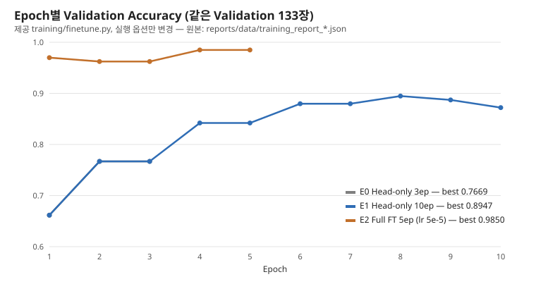

# 산출물 1. Fine-tuning 결과보고서

- 평가 대상: 콩잎 질병 이미지 3클래스 분류
- 기준 모델: microsoft/resnet-18
- 학습 방식: **Head-only** (Backbone freeze, `--freeze-backbone`) — 전체 모델 학습 아님
- 입력 데이터: `dataset/train`, `dataset/val` / 최종 보관: `dataset/test` (학습·모델 선택에 사용하지 않음)
- 모델 저장 위치: `artifacts/beans_resnet18/`
- 학습 환경: 프로젝트 전용 `.venv` (Python 3.11.17, torch 2.15.0+cu132, transformers 4.57.6), GPU RTX 3060
- 실험 상태: Head-only 학습(필수) + 개선 실험 E1·E2 + 최종 모델 Test 1회 평가 완료 (2026-11-04)

## 1. 데이터 구성

출처: Hugging Face [AI-Lab-Makerere/beans](https://huggingface.co/datasets/AI-Lab-Makerere/beans) `data/train.zip`, `data/validation.zip`, `data/test.zip`. 배치는 `scripts/prepare_data.py`, 결과 원본 [dataset_check.json](data/dataset_check.json).

| 클래스 | Train | Validation | Test |
|---|---:|---:|---:|
| angular_leaf_spot | 345 | 44 | 43 |
| bean_rust | 348 | 45 | 43 |
| healthy | 341 | 44 | 42 |
| 합계 | 1,034 | 133 | 128 |

- 원본 보존: `beans_source/zips/`(zip), `beans_source/train|validation|test/`(압축 해제본) — Git 제외
- 매핑: 원본 `train` → `dataset/train`, **원본 `validation` → `dataset/val`**, 원본 `test` → `dataset/test`
- 제외: `train/healthy/healthy_train.120tore` 1개 — 이미지가 아닌 macOS `.DS_Store` 파일(시작 바이트 `Bud1`). 제외 후 Train 1,034장 = 데이터 카드 수량
- 정답: 폴더 라벨을 그대로 따름
- 클래스 균형: split마다 세 클래스 수 차이 최대 4장
- 중복·누출 점검: 전체 1,295장 SHA-256 비교 → 같은 내용 0쌍, split 간 중복 0쌍, 파일명 겹침 0건
- 한계: 해시는 **완전히 같은 파일**만 찾음. 같은 잎을 다시 찍은 사진(거의 같은 이미지)은 확인하지 못함

zip 원본 SHA-256:

```text
284fe8456ce20687f4367ae7ad94a64577e7f9fde2c2c6b1c74340ab5dc82715  train.zip
90b7aa1c26d91d9afff07a30bbc67a5ea34f1f1397f068d8675be09d7d0c602d  validation.zip
ca67b15d960d1e2fd9d23fd8498ce86818ead90755c630a43baf19ec4af09312  test.zip
```

## 2. 실행 설정

| 파라미터 | 값 |
|---|---|
| base_model | microsoft/resnet-18 |
| epochs | 3 |
| batch_size | 8 |
| learning_rate | 0.0002 (제공 코드 기본값) |
| freeze_backbone | True — `classifier.`로 시작하는 파라미터만 학습 |
| output | artifacts/beans_resnet18 |
| seed | 42 (제공 코드) |
| 장치 | GPU (CUDA 자동 사용) |

```bash
source .venv/bin/activate
python -m training.finetune --data dataset --output artifacts/beans_resnet18 --epochs 3 --batch-size 8 --freeze-backbone
```

출력층 교체 확인 (학습 로그): `classifier.1.weight` `[1000, 512]` → `[3, 512]`, `classifier.1.bias` `[1000]` → `[3]` 새로 초기화

## 3. 학습 결과 (`training_report.json`과 일치)

| Epoch | Train Loss | Validation Accuracy |
|---|---:|---:|
| 1 | 0.9924 | 0.6617 |
| 2 | 0.8108 | 0.7669 |
| 3 | 0.7078 | 0.7669 |

- Best Validation Accuracy: **0.7669** (133장 중 102장)
- 저장된 모델: **Epoch 2** 가중치 — 제공 코드는 `acc > best_acc`일 때만 저장, 같은 값인 Epoch 3은 저장 안 함
- Train Loss가 3 Epoch 내내 감소 → 아직 수렴 전 (E1에서 10 Epoch로 확인, §6)
- Test Accuracy: 0.7188 — 제공 코드에는 Test 평가가 없어 추가 스크립트로 최종 모델 선정 뒤 1회 측정 (§6-1)
- 증빙: [학습 로그](evidence/train_log_head_only.txt), [training_report.json 사본](data/training_report_head_only.json), [환경·모델 폴더](evidence/train_env_and_model.txt)

**재현성 확인:** 같은 명령을 다른 Python 환경(수업용 가상환경)에서 먼저 실행했던 모델과, 프로젝트 전용 `.venv`에서 다시 학습한 모델의 `model.safetensors` SHA-256이 같다(`c4ba88e1…`, 가중치 차이 0.0). seed 42 고정과 같은 패키지 버전 덕분이다. 이 보고서의 모든 수치는 `.venv`에서 다시 만든 것이다 ([E-04](07_기능테스트_오류분석.md)).

### 3-1. Validation 세부 평가 (추가 스크립트 `training/evaluate.py`)

제공 코드는 정확도만 출력하므로, `finetune.py`의 데이터 읽기·전처리(`FolderImages`)를 그대로 쓰는 평가 스크립트를 **새 파일로 추가**했다.

```bash
python -m training.evaluate --model artifacts/beans_resnet18 --split val
```

- 데이터: `dataset/val` 133장 / 모델: `artifacts/beans_resnet18` / 장치: cuda
- Accuracy: **0.7669** (102/133), Macro F1: 0.764
- 평균 1순위 점수: 맞힌 것 0.6071, 틀린 것 0.504

| 클래스 | Precision | Recall | F1 | 장수 |
|---|---:|---:|---:|---:|
| angular_leaf_spot | 0.7857 | 0.75 | 0.7674 | 44 |
| bean_rust | 0.725 | 0.6444 | 0.6824 | 45 |
| healthy | 0.7843 | 0.9091 | 0.8421 | 44 |

혼동행렬 (행 = 정답, 열 = 예측):

| 정답 \ 예측 | angular_leaf_spot | bean_rust | healthy |
|---|---:|---:|---:|
| angular_leaf_spot | 33 | 8 | 3 |
| bean_rust | 8 | 29 | 8 |
| healthy | 1 | 3 | 40 |

- Accuracy 0.7669가 학습 로그 Best Val과 같음 → 평가 조건이 학습 때와 일치
- 가장 약한 클래스 **bean_rust** (Recall 0.6444): 45장 중 8장 angular_leaf_spot, 8장 healthy로 예측
- 병든 잎을 healthy로 놓친 경우 11장 (angular 3 + rust 8) — 질병 분류에서 가장 위험한 오류
- 틀린 예측의 평균 1순위 점수(0.504)가 맞힌 예측(0.6071)보다 낮음 → 낮은 점수를 "확인 필요"로 돌리는 규칙의 근거 (제안, 미구현)
- 틀린 이미지 31장: [eval_beans_resnet18_val.json](data/eval_beans_resnet18_val.json) `errors`

## 4. 생성 파일 확인

| 파일 | 크기 |
|---|---:|
| config.json (`id2label`: 0 angular_leaf_spot, 1 bean_rust, 2 healthy) | 808 B |
| model.safetensors | 44.8 MB |
| preprocessor_config.json | 352 B |
| training_report.json | 468 B |

모델 파일은 Git에 올리지 않음. 폴더 목록: [train_env_and_model.txt](evidence/train_env_and_model.txt)

## 5. 서비스 연결 확인

`.env` `MODEL_PATH=artifacts/beans_resnet18_full`(최종 선정 E2, §6), FastAPI·Celery를 `.venv`에서 실행 (2026-11-04). E0로 같은 절차를 실행한 기록은 [service_e0](evidence/service_e0/)에 보관.

- 모든 응답의 `model_id` = `artifacts/beans_resnet18_full`, 라벨은 3클래스만 → 원본 1,000클래스가 아니라 학습한 모델이 쓰임
- 서비스 측정에 쓴 **Validation** 이미지 12장 (캐시 HIT 중복 제외):

| run_id | 경로 | 파일 | 정답 | 예측 | 점수 | 일치 |
|---:|---|---|---|---|---:|:-:|
| 0 | sync | `val/angular_leaf_spot/angular_leaf_spot_val.0.jpg` | angular_leaf_spot | angular_leaf_spot | 0.998 | O |
| 0 | async | `val/bean_rust/bean_rust_val.0.jpg` | bean_rust | bean_rust | 0.997 | O |
| 1 | sync | `val/healthy/healthy_val.0.jpg` | healthy | healthy | 0.910 | O |
| 2 | sync | `val/angular_leaf_spot/angular_leaf_spot_val.1.jpg` | angular_leaf_spot | angular_leaf_spot | 0.998 | O |
| 3 | sync | `val/bean_rust/bean_rust_val.1.jpg` | bean_rust | bean_rust | 0.996 | O |
| 4 | sync | `val/healthy/healthy_val.1.jpg` | healthy | healthy | 0.900 | O |
| 5 | sync | `val/angular_leaf_spot/angular_leaf_spot_val.10.jpg` | angular_leaf_spot | angular_leaf_spot | 0.987 | O |
| 1 | async | `val/bean_rust/bean_rust_val.10.jpg` | bean_rust | bean_rust | 0.999 | O |
| 2 | async | `val/healthy/healthy_val.10.jpg` | healthy | healthy | 0.995 | O |
| 3 | async | `val/angular_leaf_spot/angular_leaf_spot_val.11.jpg` | angular_leaf_spot | angular_leaf_spot | 0.965 | O |
| 4 | async | `val/bean_rust/bean_rust_val.11.jpg` | bean_rust | bean_rust | 0.997 | O |
| 5 | async | `val/healthy/healthy_val.11.jpg` | healthy | healthy | 1.000 | O |

12장 중 12장 일치 — 동작 확인용 표본이며 정확도 지표가 아님. 증빙 [api_responses.json](evidence/api_responses.json)

> **Test 사용 기록:** 처음 02 방식(전부 Docker)으로 측정할 때 Test 이미지 15장을 시연·측정에 썼고 예측 결과를 봤다(모델·설정 선택에는 쓰지 않음). 이후 시연·측정은 모두 Validation 이미지로 바꿨다 ([E-05](07_기능테스트_오류분석.md)). 기록: [docker_mode_02/api_responses.json](evidence/docker_mode_02/api_responses.json)

## 6. 개선 실험 (평가 가이드 6-1, 같은 Validation 133장 기준)

모든 실험은 제공 `training/finetune.py`를 **고치지 않고 실행 옵션만** 바꿨다. 결과는 각각 다른 폴더에 저장해 E0(`artifacts/beans_resnet18`)를 덮어쓰지 않았다. 학습은 모두 프로젝트 `.venv`, GPU.

| 실험 | 제공 코드 변경 | 실행 설정 | Best Epoch | Val Accuracy | Val Macro F1 | Val Recall (angular / rust / healthy) | 결론 |
|---|---|---|---:|---:|---:|---|---|
| E0 Head-only 기준선 | 없음 | `--freeze-backbone`, 3 Epoch, lr 2e-4 | 2 | 0.7669 | 0.764 | 0.75 / 0.6444 / 0.9091 | 기준선 (필수) |
| E1 Head-only 10 Epoch | 없음 | `--freeze-backbone --epochs 10` → `artifacts/beans_resnet18_head10` | 8 | 0.8947 | 0.8953 | 0.8864 / 0.8667 / 0.9318 | E0 대비 +12.78%p |
| E2 Full Fine-tuning | 없음 | 옵션 없음(전체 학습), `--epochs 5 --lr 0.00005` → `artifacts/beans_resnet18_full` | 4 | **0.985** | **0.985** | 1.0 / 0.9556 / 1.0 | E0 대비 +21.81%p, **최종 선정** |



- E1: Backbone을 고정한 채 Epoch만 늘려도 Val이 0.7669 → 0.8947. E0는 3 Epoch에서 덜 학습된 상태였다 (Loss 0.71 → 10 Epoch 0.49). 8 Epoch 이후 Val이 0.8872, 0.8722로 내려가 더 늘려도 이득이 작다
- E2: Backbone까지 학습하니 1 Epoch 만에 Val 0.9699. 녹병 Recall 0.6444 → 0.9556, 병든 잎을 healthy로 놓친 경우 11장 → 1장
- E2는 학습률을 제공 기본값(2e-4)의 1/4인 5e-5로 낮췄다. 사전학습된 Backbone 가중치를 크게 망가뜨리지 않기 위해서다 (평가 가이드 6-1 예시와 같은 값)
- 세부 지표: [E1 Val](data/eval_beans_resnet18_head10_val.json), [E2 Val](data/eval_beans_resnet18_full_val.json), 학습 로그 [E1](evidence/train_log_e1_head10.txt) · [E2](evidence/train_log_e2_full.txt)

### 6-1. 최종 모델 선정과 Test 1회 평가

선정 기준(Validation Accuracy 최고, 같으면 Macro F1)과 결과를 **Test를 보기 전에** [model_selection.md](data/model_selection.md)로 커밋했다 (커밋 `1853f29`). 선정: **E2**. 그 뒤 E0(필수 기준선)와 E2(최종)만 Test로 각 1회 평가했다. E1은 선정되지 않아 Test에 쓰지 않았다.

```bash
python -m training.evaluate --model artifacts/beans_resnet18 --split test --final
python -m training.evaluate --model artifacts/beans_resnet18_full --split test --final
```

| 모델 | Test Accuracy | Test Macro F1 | Test Recall (angular / rust / healthy) | Val Accuracy (비교) |
|---|---:|---:|---|---:|
| E0 Head-only | 0.7188 (92/128) | 0.7109 | 0.6977 / 0.5349 / 0.9286 | 0.7669 |
| E2 Full Fine-tuning (최종) | **0.9766** (125/128) | **0.9765** | 1.0 / 0.9302 / 1.0 | 0.985 |

E2 Test 세부:

- 데이터: `dataset/test` 128장 / 모델: `artifacts/beans_resnet18_full` / 장치: cuda
- Accuracy: **0.9766** (125/128), Macro F1: 0.9765
- 평균 1순위 점수: 맞힌 것 0.9593, 틀린 것 0.754

| 클래스 | Precision | Recall | F1 | 장수 |
|---|---:|---:|---:|---:|
| angular_leaf_spot | 0.9556 | 1.0 | 0.9773 | 43 |
| bean_rust | 1.0 | 0.9302 | 0.9639 | 43 |
| healthy | 0.9767 | 1.0 | 0.9882 | 42 |

혼동행렬 (행 = 정답, 열 = 예측):

| 정답 \ 예측 | angular_leaf_spot | bean_rust | healthy |
|---|---:|---:|---:|
| angular_leaf_spot | 43 | 0 | 0 |
| bean_rust | 2 | 40 | 1 |
| healthy | 0 | 0 | 42 |

- E2는 Test에서도 0.9766으로 Val(0.985)과 비슷 → Validation으로 고른 결과가 처음 보는 데이터에서도 유지됨
- E0 → E2: Test Accuracy 0.7188 → 0.9766, **25.78%p** 상승 (비율 상승률이 아님)
- E2가 틀린 3장은 모두 bean_rust (2장 → angular_leaf_spot, 1장 → healthy). 목록: [eval_beans_resnet18_full_test.json](data/eval_beans_resnet18_full_test.json) `errors`
- Test 실행 기록 ([test_runs.log](data/test_runs.log)) — 2회뿐:

```text
2026-11-04T12:39:19+09:00	artifacts/beans_resnet18	accuracy=0.7188
2026-11-04T12:39:23+09:00	artifacts/beans_resnet18_full	accuracy=0.9766
2026-11-05T09:14:36+09:00	artifacts/beans_resnet18_full	review_rule features (CNN 점수+HSV, 규칙 확정 후)
```

- 주의: 처음 02 방식 측정 때 E0로 Test 이미지 15장의 예측을 본 적이 있다 ([E-05](07_기능테스트_오류분석.md)). 이후 모델·설정 선택은 Validation만으로 했다.

### 6-2. 서비스 모델 — E2로 전환

평가 가이드 예시 경로는 `artifacts/beans_resnet18`(E0)이지만, Validation으로 고른 최종 모델을 서비스에 쓰기 위해 `.env`를 `MODEL_PATH=artifacts/beans_resnet18_full`로 바꾸고 FastAPI·Worker를 재시작했다. 코드 수정은 없다. 산출물 2~7의 서비스 실측·테스트·캡처는 **E2 기준**으로 다시 했다. E0로 먼저 같은 절차를 돌린 기록은 [evidence/service_e0](evidence/service_e0/)·[data/service_e0](data/service_e0/)에 그대로 보관했다 (가이드와 다른 점은 모델 경로 하나).

같은 측정 스크립트(`scripts/bench_api.py`, 같은 Validation 12장, 조건별 5회)의 중앙값:

| 항목 (ms) | 서비스 E0 | 서비스 E2 |
|---|---:|---:|
| Sync MISS 응답 | 22.8 | 22.0 |
| Sync MISS 추론 | 18.0 | 17.0 |
| Sync HIT 응답 | 1.7 | 1.4 |
| Async 접수(202) | 8.5 | 10.6 |
| Async MISS 최종 | 117.1 | 117.8 |
| Async HIT 최종 | 116.8 | 116.7 |

구조가 같은 ResNet-18이라 추론 시간은 같은 수준이다. 측정 표본 12장의 예측 일치는 E0 6/12 → E2 12/12 (동작 확인용 표본이며 정확도 지표는 §6-1의 Test).

### 6-3. CNN + 규칙 후처리 "확인 필요" 실험 (가이드 6-2·6-3, 실행)

모델 라벨은 바꾸지 않고, 사람이 다시 봐야 할 사진에만 `review_required` 플래그를 붙이는 실험이다. **모델 성능(Accuracy)과 후처리 시스템 성능(보류율·자동 통과분 정확도)을 따로** 적는다. 코드: `scripts/review_rule.py` (추가 파일, 분석용 패키지는 `requirements-analysis.txt`의 OpenCV만, 서비스 API에는 넣지 않음).

**OpenCV 특징 (교과 9 방식):** BGR→HSV → 녹색 `inRange`(H 33~90, S·V ≥ 40) → Opening → 큰 외곽선을 채워 잎 마스크 → 잎 안의 녹색이 아닌 픽셀 = 병반 후보 → Opening → `병반 후보 면적비 = 병반 픽셀 / 잎 픽셀`. 예시: [figures/hsv_examples](figures/hsv_examples/) (빨강 = 병반 후보, 하늘색 = 잎 경계).

**기준 정하는 순서 (누출 방지):**
1. 면적비 기준: **Train** 1,034장 중 healthy 사진의 95백분위 = 0.1006
2. 점수 기준: **Validation**에서 0.5~0.95 비교, 선정 규칙 "보류율 10% 이하에서 잡은 오류 최대" → 선정 기록을 커밋(`c16a2b8`)한 뒤
3. **Test**에 한 번 적용 (`test_runs.log` 기록)

**결과 1 — HSV 면적비는 거의 도움이 안 됐다 (부정적 결과).** Train에서 면적비 중앙값이 healthy 0.0245 대 병든 잎 0.0385로 차이가 작고, 병든 잎 중 healthy 95백분위를 넘는 것은 4.8%뿐이다. 녹병 초기 반점은 작고 옅은 황록색이라 녹색 구간에 섞이고, 흙·그림자가 잎 가장자리에 들어오면 병반으로 잡힌다. 그래서 면적비 규칙을 켜도 결과가 같았다 (E0 Val: 1장 추가 보류, E2 Val: 변화 없음).

**결과 2 — CNN 점수 기준 보류는 효과가 있었다.** 최종 규칙: `top1 score < 0.9` → 확인 필요.

| E2 + 규칙 | 보류율 | 잡은 오류 | 자동 통과분 정확도 |
|---|---:|---:|---:|
| Validation (기준 선정용) | 5.3% (7/133) | 2/2 | 1.0 (126장) |
| **Test (1회)** | 14.1% (18/128) | 2/3 | 0.9909 (110장) |

- Test: 모델 Accuracy는 그대로 0.9766 (오류 3장). 규칙을 붙이면 18장을 사람에게 넘기고, 자동으로 통과시킨 110장의 정확도가 0.9909. 오류 3장 중 2장(점수 0.65, 0.71)을 잡고, 1장(bean_rust → angular_leaf_spot, 점수 0.90)은 놓쳤다.
- Test 보류율 14.1%는 Val(5.3%)보다 높다. Val 133장에서 정한 기준이라 표본 차이가 그대로 드러난 것이고, Test를 보고 기준을 다시 고치지 않았다.
- E0에는 같은 방식이 맞지 않았다: 점수 0.5만 써도 Val 보류율 31.6% (오류 18/31 잡음). 모델이 약하면 후처리로 메우기보다 모델 개선(E2)이 먼저였다.

## 7. 결과 판정과 한계

- 완료: 제공 코드로 Head-only Fine-tuning(필수) 실행, 3클래스 모델 생성, 서비스에서 이 모델 사용 확인
- 개선: 실행 옵션만 바꾼 Full Fine-tuning(E2)이 Validation 0.985, Test 0.9766로 가장 좋음 (E0 Test 0.7188)
- 후처리: CNN 점수 < 0.9 보류 규칙으로 Test 자동 통과분 정확도 0.9909 (보류율 14.1%), HSV 면적비 규칙은 효과 없음 (§6-3)
- 한계: 실험마다 학습 1회(seed 42 하나), 거의 같은 사진 중복은 미점검, Test 128장은 작은 표본이라 1장 = 0.78%p
