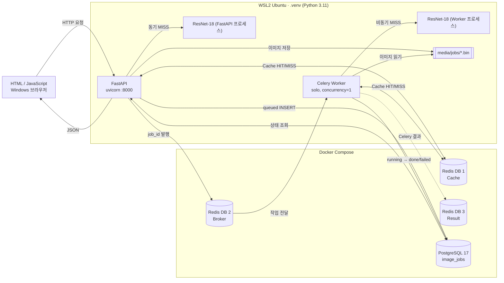

# 산출물 2. 시스템 아키텍처

- 확인일: 2026-11-04
- 실행 구조: **평가 가이드 방식** — FastAPI·Celery는 WSL2 프로젝트 `.venv`, Docker Compose는 Redis·PostgreSQL만

## 구성도

모델은 FastAPI와 Worker가 **각자 따로** 불러온다 (`ai/hf_model.py`의 `lru_cache`, 프로세스별 첫 요청 때 로드). 그래서 첫 동기 요청 2957.8 ms, 첫 비동기 작업 추론 2739.24 ms가 걸렸다 ([산출물 6](06_성능비교_보고서.md) 워밍업).

## 컴포넌트 역할

| 컴포넌트 | 실행 위치 | 사용 파일 / 서비스 | 역할 |
|---|---|---|---|
| 브라우저 | Windows 웹브라우저 | `templates/sync.html`, `templates/async.html` | 파일 업로드·결과 표시, 비동기는 1초마다 상태 조회 |
| FastAPI | WSL2 `.venv` (터미널 2) | `main.py`, `ai/router_web.py`, `ai/router_sync.py`, `ai/router_async.py` | HTTP 요청 검증·동기 추론·작업 접수·조회 |
| ResNet-18 | WSL2 FastAPI / Worker 각 프로세스, CPU | `ai/hf_model.py`, `ai/services.py`, `artifacts/beans_resnet18/` | 3클래스 분류 |
| Redis Cache | Docker Redis DB 1 | `ai/cache_service.py` | 키 `vision:classify:<모델해시16>:<이미지SHA-256>`, TTL 600초. 장애 시 추론으로 진행 |
| Redis Broker | Docker Redis DB 2 | `ai/celery_app.py` | Celery 작업 전달 |
| Redis Result | Docker Redis DB 3 | `ai/celery_app.py` | Celery 작업 결과 (서비스 응답은 PostgreSQL에서 읽음) |
| PostgreSQL | Docker | `ai/database.py`, `ai/models.py`, `image_jobs` | 비동기 작업 상태·결과 |
| Celery Worker | WSL2 `.venv` (터미널 1) | `ai/tasks.py` | 비동기 추론·DB 갱신 |
| 업로드 파일 | WSL2 `media/jobs/` | `ai/router_async.py` | `<uuid>.bin`으로 저장, Worker가 읽음 (DB에는 경로만) |

## 실행환경

| 항목 | 값 |
|---|---|
| 운영체제 | Windows 11 Pro + WSL2 Ubuntu 26.04.1 LTS (커널 6.18.54.1-microsoft-standard-WSL2) |
| Python 가상환경 | 프로젝트 전용 `~/kh-subject9-eval-beans/.venv` — Python 3.11.17 (uv), `requirements.txt`만 설치 |
| 주요 패키지 | torch 2.15.0+cu132, transformers 4.57.6, fastapi 0.162.0, uvicorn 0.54.0, celery 5.6.3, redis-py 6.4.0, SQLAlchemy 2.1.8, psycopg 3.3.7 (전체: [train_env_and_model.txt](evidence/train_env_and_model.txt)) |
| Docker 서비스 | Docker Desktop 29.8.2, Compose v5.6.0 — **redis:7.4-alpine(7.4.12), postgres:17-alpine(17.11)만 실행** |
| 서버 프로세스 | FastAPI: `uvicorn main:app --host 127.0.0.1 --port 8000` (.venv) |
| 워커 프로세스 | Celery: `celery -A ai.celery_app:celery_app worker --loglevel=info --pool=solo --concurrency=1` (.venv, 별도 터미널) |
| CPU / RAM / GPU | Intel i7-12700 (WSL 20 스레드) / WSL 15 GiB / RTX 3060 12GB |
| 추론 장치 | 학습·평가 스크립트는 GPU(CUDA). **서비스 추론은 CPU** — `ai/hf_model.py`가 `pipeline(..., device=-1)` |
| 모델 경로 | `.env` `MODEL_PATH=artifacts/beans_resnet18` |

## 구조 검증 결과

| 확인 | 결과 | 증빙 |
|---|---|---|
| Docker에는 Redis·PostgreSQL만 | `docker compose ps` → `redis`, `postgres` 2개 (healthy) | [environment_and_status.txt](evidence/environment_and_status.txt) |
| FastAPI·Celery는 `.venv` | `ps` → `/home/user1/kh-subject9-eval-beans/.venv/bin/uvicorn …`, `…/.venv/bin/celery …` | 같은 파일 |
| FastAPI | `/health` → `{"status":"ok"}` | 같은 파일 |
| Redis / PostgreSQL | `PONG` / `accepting connections` | 같은 파일 |
| Celery 연결 | `transport: redis://…127.0.0.1:6379/2`, `[tasks] . ai.classify_job`, `ready.` | [celery_worker_log.txt](evidence/celery_worker_log.txt) |
| 동기 경로 | 브라우저 → FastAPI → Redis Cache(MISS) → ResNet-18 → FastAPI → 브라우저 | [산출물 5](05_AI버튼_처리흐름.md) |
| 비동기 경로 | 브라우저 → FastAPI → PostgreSQL(queued) → Redis Broker → Worker → PostgreSQL(done) → 브라우저 조회 | [산출물 4](04_DB_구조_작업이력.md) |
| 동기 요청의 DB 기록 | 제공 코드는 저장하지 않음 (`image_jobs`는 비동기만) | — |

### 참고: 제공 문서 02 방식

제공 문서 02의 `compose.yaml`은 FastAPI(`web`)·Celery(`worker`)까지 컨테이너로 띄우는 구성이다. 같은 코드로 이 방식도 먼저 실행해 동작을 확인했고 기록은 [docker_mode_02](evidence/docker_mode_02/)에 보관했다. **제출 기준 구조와 수치는 위의 평가 가이드 방식이다.** 두 방식은 코드 수정 없이 주소만 다르다 — `.venv`는 `ai/config.py` 기본값 `127.0.0.1`, 컨테이너는 `compose.yaml` 환경변수의 서비스명(`redis`, `postgres`).
