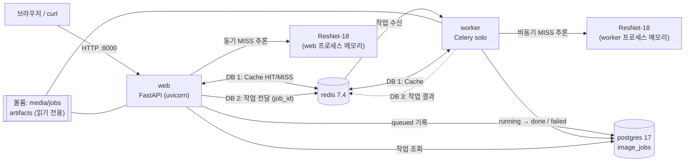

# 산출물 2. 시스템 아키텍처

- 확인일: 2026-11-04
- 실행 방식: 제공 문서 02의 `compose.yaml` 그대로 — `web`, `worker`, `redis`, `postgres` 4개 컨테이너 (`trainer`는 `train` 프로필이라 기본 실행에서 빠짐)

## 구성도

모델은 web과 worker가 **각자 따로** 불러온다(`ai/hf_model.py`의 `lru_cache`, 프로세스별 최초 요청 때 로드). 그래서 첫 동기 요청과 첫 비동기 작업이 각각 약 2.3초 걸렸다([산출물 6](06_성능비교_보고서.md) 워밍업).

## 컴포넌트 역할

| 컴포넌트 | 실행 위치 | 사용 파일 / 서비스 | 역할 |
|---|---|---|---|
| web | 컨테이너 `kh-subject9-eval-beans-web-1`, `127.0.0.1:8000` | `main.py`, `ai/router_web.py`, `ai/router_sync.py`, `ai/router_async.py`, `templates/` | 화면 제공, 동기 추론, 비동기 작업 접수·조회 |
| worker | 컨테이너 `…-worker-1` (포트 공개 없음) | `ai/celery_app.py`, `ai/tasks.py` | 큐에서 `ai.classify_job`을 받아 추론하고 DB 갱신 (`--pool=solo --concurrency=1`) |
| 모델 | web·worker 각 프로세스 | `ai/hf_model.py`, `ai/services.py`, `artifacts/beans_resnet18/` | 3클래스 분류, `top_k=5` 결과 정렬 |
| 캐시 | redis DB 1 | `ai/cache_service.py` | 키 `vision:classify:<모델해시16>:<이미지SHA-256>`, TTL 600초, 장애 시 추론으로 진행 |
| 브로커 / 결과 | redis DB 2 / DB 3 | `ai/celery_app.py` | Celery 작업 전달 / Celery 결과 저장 |
| 작업 기록 | postgres `vision_db.image_jobs` | `ai/database.py`, `ai/models.py` | 비동기 작업 상태·결과 저장 (동기 요청은 기록하지 않음) |
| 업로드 파일 | 볼륨 `./media/jobs` | `ai/router_async.py` | 비동기 요청 이미지를 `<uuid>.bin`으로 저장, worker가 읽음 |

## 실행환경

| 항목 | 값 |
|---|---|
| 운영체제 | Windows 11 Pro + WSL2 Ubuntu 26.04.1 LTS (커널 6.18.54.1-microsoft-standard-WSL2) |
| Docker | Docker Desktop 29.8.2, Compose v5.6.0 (WSL integration) |
| CPU / RAM / GPU | Intel i7-12700 (WSL에 20 스레드) / WSL 15 GiB / RTX 3060 12GB — **서비스 컨테이너는 CPU만 사용** (`torch 2.5.1+cpu`, `cuda False`, 로그 `Device set to use cpu`) |
| 컨테이너 Python 패키지 | Python 3.11.18, torch 2.5.1+cpu, transformers 4.57.6, fastapi 0.162.0, celery 5.6.3, redis-py 6.4.0, SQLAlchemy 2.1.8 |
| Redis / PostgreSQL | redis:7.4-alpine (7.4.12) / postgres:17-alpine (17.11) |
| 이미지 크기 | web·worker 각 2.53 GB, redis 57.8 MB, postgres 424 MB |

## 구조 검증 결과

| 확인 | 명령 | 결과 | 증빙 |
|---|---|---|---|
| 4개 컨테이너 실행 | `docker compose ps` | web·redis·postgres `healthy`, worker `Up` | [environment_and_status.txt](evidence/environment_and_status.txt) |
| FastAPI | `curl http://127.0.0.1:8000/health` | `{"status":"ok"}` | 같은 파일 |
| Redis | `docker compose exec redis redis-cli ping` | `PONG` | 같은 파일 |
| PostgreSQL | `docker compose exec postgres pg_isready -U vision_user -d vision_db` | `accepting connections` | 같은 파일 |
| Celery 연결 | worker 로그 | `Connected to redis://…:6379/2`, `[tasks] . ai.classify_job`, `celery@… ready.` | [celery_worker_log.txt](evidence/celery_worker_log.txt) |
| 모델 경로 | 응답의 `model_id` | `artifacts/beans_resnet18` (원본 `microsoft/resnet-18`이 아님), 라벨 3개만 출력 | [api_responses.json](evidence/api_responses.json) |

포트 충돌: 같은 PC에서 수업 실습 컨테이너(`fastapi_resnet18-redis-1`, `fastapi_resnet18-postgres-1`)가 6379·5432를 쓰고 있어 정지 후 실행 ([산출물 7](07_기능테스트_오류분석.md) E-01).
