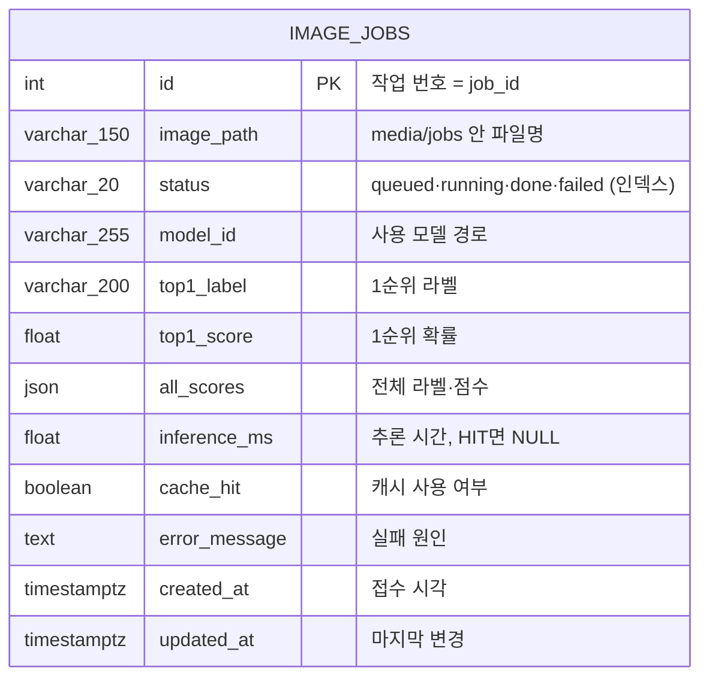
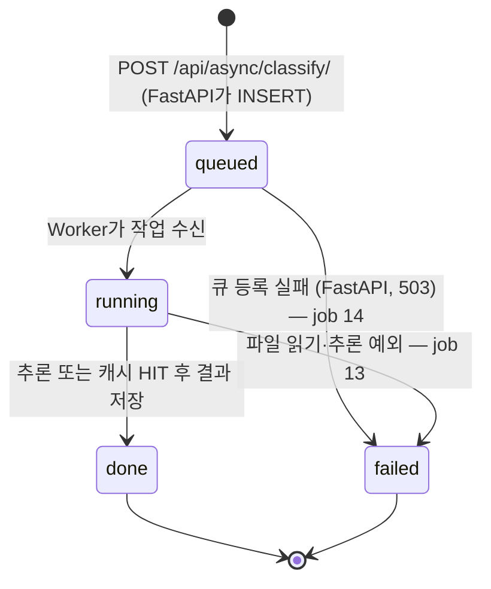
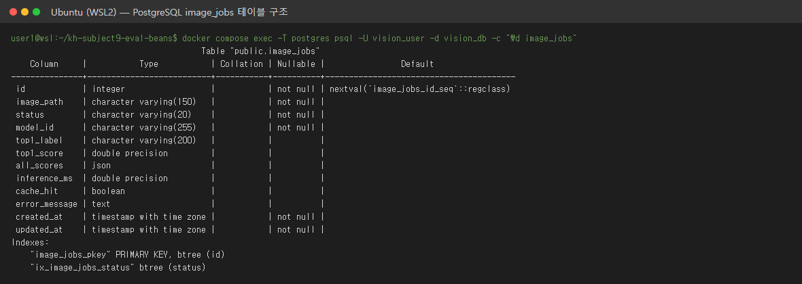
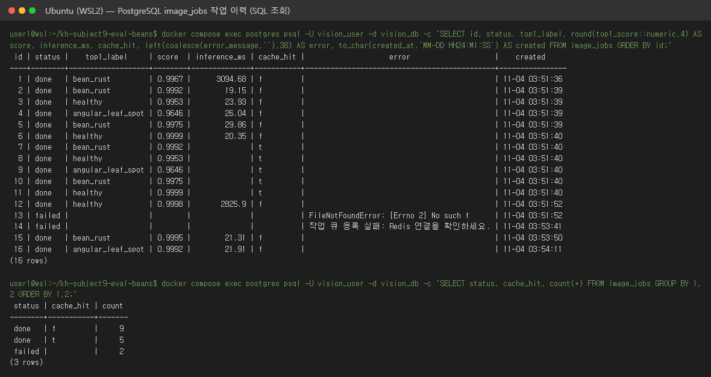

# 산출물 4. DB 구조·작업이력

**테이블명:** `image_jobs` · **PK:** `id` · **저장 대상:** 비동기 추론의 작업 상태와 결과 · PostgreSQL 17 `vision_db` (Docker)

테이블은 FastAPI 시작 시 `Base.metadata.create_all`로 생성된다. 테이블은 하나뿐이며 FK·관계 테이블은 없다. 실제 스키마: [db_schema.txt](evidence/db_schema.txt)



| 컬럼 | DB 자료형 (실제 스키마) | Nullable / 기본 | 예시 값 (이번 실행) | 사용 이유 |
|---|---|---|---|---|
| id | integer, PK, 시퀀스 | NOT NULL | 2 | 고유 작업번호, 응답의 `job_id` |
| image_path | varchar(150) | NOT NULL | `16ff7c91….bin` | 업로드 파일 찾기. 사용자 파일명 대신 UUID |
| status | varchar(20), 인덱스 | NOT NULL, `queued` | done | 처리 상태 |
| model_id | varchar(255) | NOT NULL, `""` | artifacts/beans_resnet18_full | 모델 식별 |
| top1_label | varchar(200) | NULL | bean_rust | 최종 분류 라벨 |
| top1_score | double precision | NULL | 0.4297 | 분류 점수 |
| all_scores | json | NULL | 라벨 3개·점수 배열 | 전체 점수 (API 응답에서는 `all`) |
| inference_ms | double precision | NULL | 18.32 | 실제 추론시간. 캐시 HIT면 NULL |
| cache_hit | boolean | NULL | false | 캐시 재사용 여부 |
| error_message | text | NULL | `FileNotFoundError: …` (job 13) | 실패 원인 (최대 1,500자) |
| created_at | timestamptz | NOT NULL, UTC 현재 | 접수 시각 | 생성 시점 |
| updated_at | timestamptz | NOT NULL, 갱신 시 변경 | 처리 완료 시각 | 갱신 시점 |

## 조회 SQL

```sql
SELECT id, status, image_path, model_id, top1_label, top1_score,
       inference_ms, cache_hit, created_at, updated_at
FROM image_jobs
ORDER BY id DESC
LIMIT 10;
```

실행: `docker compose exec postgres psql -U vision_user -d vision_db -c "<SQL>"`. 증빙은 전체 행을 보려고 `ORDER BY id`로 조회하고 `top1_score` 소수 4자리, `error_message` 앞 60자만 표시했다.

## 조회 결과 (2026-11-04, [db_image_jobs.txt](evidence/db_image_jobs.txt))

```text
$ SELECT ... FROM image_jobs ORDER BY id  (2026-11-04 12:54:23 +0900)
 id | status |              image_path              |           model_id            |    top1_label     | top1_score | inference_ms | cache_hit |                        error_message                         |          created_at           |          updated_at           
----+--------+--------------------------------------+-------------------------------+-------------------+------------+--------------+-----------+--------------------------------------------------------------+-------------------------------+-------------------------------
  1 | done   | 9a26313d96b4474889b1c5b6c6cf60be.bin | artifacts/beans_resnet18_full | bean_rust         |     0.9967 |      3094.68 | f         |                                                              | 2026-11-04 03:51:36.345845+00 | 2026-11-04 03:51:39.501233+00
  2 | done   | 5c28c724d7a542f88063428ccee53017.bin | artifacts/beans_resnet18_full | bean_rust         |     0.9992 |        19.15 | f         |                                                              | 2026-11-04 03:51:39.631004+00 | 2026-11-04 03:51:39.66219+00
  3 | done   | 60d2e192db1a4b09b3b0708bf87988f6.bin | artifacts/beans_resnet18_full | healthy           |     0.9953 |        23.93 | f         |                                                              | 2026-11-04 03:51:39.750823+00 | 2026-11-04 03:51:39.795429+00
  4 | done   | c0f51db1913f45ee9686d6c1d056ab82.bin | artifacts/beans_resnet18_full | angular_leaf_spot |     0.9646 |        26.04 | f         |                                                              | 2026-11-04 03:51:39.876931+00 | 2026-11-04 03:51:39.919788+00
  5 | done   | 4028d6b7259d4009b9e5bb92617a7a78.bin | artifacts/beans_resnet18_full | bean_rust         |     0.9975 |        29.86 | f         |                                                              | 2026-11-04 03:51:39.997026+00 | 2026-11-04 03:51:40.041481+00
  6 | done   | 45793814e27a41f587f0f07f86a5bcb9.bin | artifacts/beans_resnet18_full | healthy           |     0.9999 |        20.35 | f         |                                                              | 2026-11-04 03:51:40.115398+00 | 2026-11-04 03:51:40.149568+00
  7 | done   | 8d18f0cbbcbb4f328b43c36cf43b754c.bin | artifacts/beans_resnet18_full | bean_rust         |     0.9992 |              | t         |                                                              | 2026-11-04 03:51:40.231358+00 | 2026-11-04 03:51:40.243948+00
  8 | done   | 3d145ee301cb4c85930f56ebb09ef101.bin | artifacts/beans_resnet18_full | healthy           |     0.9953 |              | t         |                                                              | 2026-11-04 03:51:40.349152+00 | 2026-11-04 03:51:40.359207+00
  9 | done   | e27368f2f4544c3086cfb5a326d9e5f0.bin | artifacts/beans_resnet18_full | angular_leaf_spot |     0.9646 |              | t         |                                                              | 2026-11-04 03:51:40.467133+00 | 2026-11-04 03:51:40.47992+00
 10 | done   | 45b6849ba7e2424389316a83189ac966.bin | artifacts/beans_resnet18_full | bean_rust         |     0.9975 |              | t         |                                                              | 2026-11-04 03:51:40.585749+00 | 2026-11-04 03:51:40.594408+00
 11 | done   | 795afa66faa5401bb728f00079c49b7c.bin | artifacts/beans_resnet18_full | healthy           |     0.9999 |              | t         |                                                              | 2026-11-04 03:51:40.701369+00 | 2026-11-04 03:51:40.711657+00
 12 | done   | a0983867bfd24910a3a2d20903836ae3.bin | artifacts/beans_resnet18_full | healthy           |     0.9998 |       2825.9 | f         |                                                              | 2026-11-04 03:51:52.160355+00 | 2026-11-04 03:53:35.348137+00
 13 | failed | b528697156b844a68d178d06949171db.bin | artifacts/beans_resnet18_full |                   |            |              |           | FileNotFoundError: [Errno 2] No such file or directory: '/ho | 2026-11-04 03:51:52.175612+00 | 2026-11-04 03:53:35.359363+00
 14 | failed | 8f04e0fa2f2d49039049bd2f3c9de0c5.bin | artifacts/beans_resnet18_full |                   |            |              |           | 작업 큐 등록 실패: Redis 연결을 확인하세요.                  | 2026-11-04 03:53:41.389754+00 | 2026-11-04 03:53:41.999065+00
 15 | done   | a062d1baf33c40b4824660f7361f0398.bin | artifacts/beans_resnet18_full | bean_rust         |     0.9995 |        21.31 | f         |                                                              | 2026-11-04 03:53:50.456337+00 | 2026-11-04 03:53:50.496517+00
 16 | done   | 85d02f89188f4daebde4eb36e952c91f.bin | artifacts/beans_resnet18_full | angular_leaf_spot |     0.9992 |        21.91 | f         |                                                              | 2026-11-04 03:54:11.953923+00 | 2026-11-04 03:54:11.989674+00
(16 rows)

 status | cache_hit | count 
--------+-----------+-------
 done   | f         |     9
 done   | t         |     5
 failed |           |     2
(3 rows)
```

| id | status | cache_hit | 판정 |
|---|---|---|---|
| 1 | done | false | 워밍업 — Worker 첫 작업이라 모델 로딩 포함 `inference_ms` 3,095 |
| 2~6 | done | false | 처음 보낸 Validation 이미지 5장, 실제 추론 (19.2~29.9 ms) |
| 7~11 | done | true | 2~6과 같은 파일 재접수 → 캐시 재사용, `inference_ms` NULL. 작업마다 파일은 새 `image_path`로 저장 |
| 12 | done | false | Worker 정지 중 접수(T-10) → 재시작 후 처리. 새 프로세스라 모델 재로딩 2,826 ms |
| 13 | **failed** | NULL | Worker 정지 중 접수 후 업로드 파일 삭제(T-16) → `FileNotFoundError` 기록 |
| 14 | **failed** | NULL | Redis 정지 중 접수(T-15) → 큐 등록 실패, FastAPI가 `failed` + 503 |
| 15 | done | false | Redis 재시작 후 접수 → Worker 재연결 확인 |
| 16 | done | false | 화면 캡처용 비동기 요청 ([ui_async_done.png](evidence/ui_async_done.png)) |

## 상태 전이



- 관찰: 0.1초 간격 조회에서 job 1은 `queued → running → done`. 나머지는 Worker 처리(약 30~45 ms)가 조회 간격보다 짧아 `queued → done`만 보임 — `running`을 못 봐도 최종 결과·DB·Worker 로그로 정상 처리 확인
- 이미지 실제 저장 위치: `media/jobs/<uuid>.bin` (DB에는 원본 바이너리를 저장하지 않음)
- 동기 요청은 DB 행을 만들지 않음 (제공 코드 기본 동작)
- 이전 02 방식 실행의 13행은 [docker_mode_02/image_jobs_dump.sql](evidence/docker_mode_02/image_jobs_dump.sql)로 백업한 뒤 테이블을 비우고 다시 시작했다 (`TRUNCATE … RESTART IDENTITY`)

## 실행 캡처

터미널 캡처는 실제 명령과 그 출력(`evidence/screens/src/*.txt`)을 `scripts/render_screens.py`로 PNG로 옮긴 것이다. 브라우저 캡처는 헤드리스 Chrome으로 실제 페이지를 찍었다.

**`image_jobs` 테이블 구조 (`\d image_jobs`)**



**`image_jobs` 작업 이력 SQL 조회 (created_at은 UTC 저장, KST = +9시간)**



