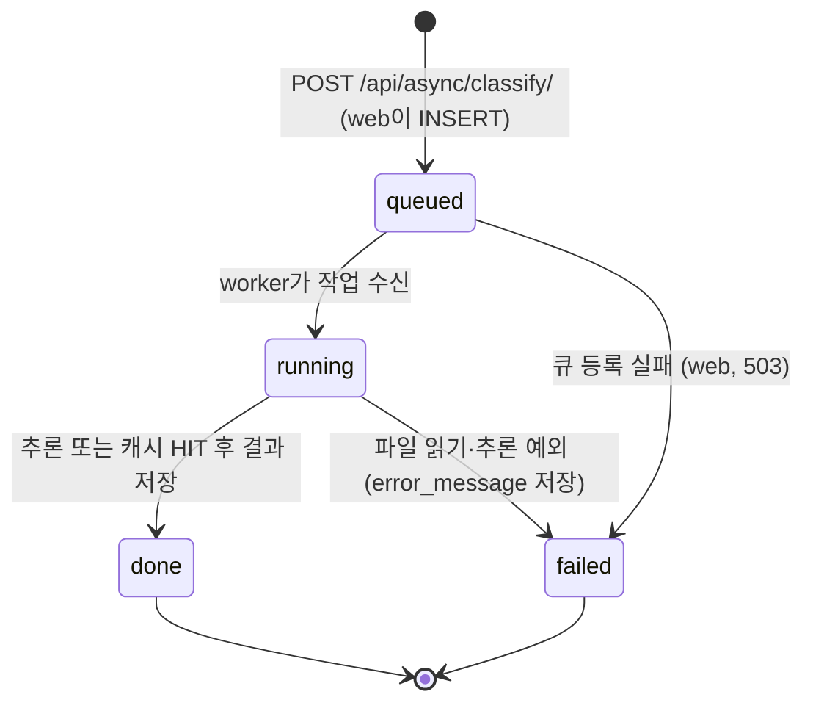

# 산출물 4. DB 구조·작업이력

PostgreSQL 17 `vision_db`, 테이블은 web 시작 시 `Base.metadata.create_all`로 생성. 실제 스키마: [evidence/db_schema.txt](evidence/db_schema.txt)

## image_jobs 테이블 (ai/models.py)

| 컬럼 | 자료형 | Nullable / 기본 | 예시 값 (job 2) | 용도 |
|---|---|---|---|---|
| id | integer, PK | NOT NULL, 시퀀스 | 2 | 작업 번호 = 응답의 `job_id` |
| image_path | varchar(150) | NOT NULL | `1f49c5bd….bin` | `media/jobs/` 안 파일명. 사용자 파일명 대신 UUID |
| status | varchar(20), 인덱스 | NOT NULL, `queued` | done | 상태 |
| model_id | varchar(255) | NOT NULL, `""` | artifacts/beans_resnet18 | 사용 모델 경로 |
| top1_label | varchar(200) | NULL | angular_leaf_spot | 1순위 라벨 |
| top1_score | double | NULL | 0.3825 | 1순위 확률 |
| all_scores | json | NULL | 3개 라벨·점수 배열 | 전체 결과 |
| inference_ms | double | NULL | 16.9 | 모델 추론 시간. 캐시 HIT면 NULL |
| cache_hit | boolean | NULL | false | Redis 캐시 사용 여부 |
| error_message | text | NULL | (없음) | 실패 원인 (최대 1,500자) |
| created_at | timestamptz | NOT NULL, UTC 현재 | 2026-11-04 02:09:22.759+00 | 접수 시각 |
| updated_at | timestamptz | NOT NULL, 갱신 시 변경 | 2026-11-04 02:09:22.789+00 | 마지막 상태 변경 |

## 조회 SQL

```bash
docker compose exec postgres psql -U vision_user -d vision_db -c "SELECT id, status, image_path, model_id, top1_label, top1_score, inference_ms, cache_hit, created_at, updated_at FROM image_jobs ORDER BY id DESC LIMIT 10;"
```

(증빙은 전체 행을 보려고 `ORDER BY id`, `LIMIT` 없이 실행했고 `top1_score`를 소수 4자리로 반올림)

## 조회 결과

2026-11-04 측정 직후 ([evidence/db_image_jobs.txt](evidence/db_image_jobs.txt)):

```text
 id | status |              image_path              |         model_id         |    top1_label     | top1_score | inference_ms | cache_hit |          created_at           |          updated_at           
----+--------+--------------------------------------+--------------------------+-------------------+------------+--------------+-----------+-------------------------------+-------------------------------
  1 | done   | 10efee405cd94d08b8f12fb94564b955.bin | artifacts/beans_resnet18 | bean_rust         |     0.6051 |      2214.16 | f         | 2026-11-04 02:09:20.318518+00 | 2026-11-04 02:09:22.597558+00
  2 | done   | 1f49c5bd237c4c7795a470b50113641a.bin | artifacts/beans_resnet18 | angular_leaf_spot |     0.3825 |         16.9 | f         | 2026-11-04 02:09:22.759201+00 | 2026-11-04 02:09:22.788987+00
  3 | done   | 2a2298c8445b45e6b85ffe1f27f82dc9.bin | artifacts/beans_resnet18 | bean_rust         |     0.5000 |        17.88 | f         | 2026-11-04 02:09:22.875718+00 | 2026-11-04 02:09:22.905636+00
  4 | done   | 434d49da360e46918c1d8c402e5388e6.bin | artifacts/beans_resnet18 | angular_leaf_spot |     0.5796 |        21.02 | f         | 2026-11-04 02:09:22.997388+00 | 2026-11-04 02:09:23.031101+00
  5 | done   | 5366e47d2c6a454789a1fc39c01e2b7d.bin | artifacts/beans_resnet18 | bean_rust         |     0.5911 |         18.2 | f         | 2026-11-04 02:09:23.118984+00 | 2026-11-04 02:09:23.14978+00
  6 | done   | 9e222a496d9648d49870b26e4038a68d.bin | artifacts/beans_resnet18 | healthy           |     0.8478 |        19.79 | f         | 2026-11-04 02:09:23.239869+00 | 2026-11-04 02:09:23.271869+00
  7 | done   | 5928652a86ed47cab7685509fe617b51.bin | artifacts/beans_resnet18 | angular_leaf_spot |     0.3825 |              | t         | 2026-11-04 02:09:23.361019+00 | 2026-11-04 02:09:23.370865+00
  8 | done   | cef9b2587ea64e03b7d85782863b6201.bin | artifacts/beans_resnet18 | bean_rust         |     0.5000 |              | t         | 2026-11-04 02:09:23.482547+00 | 2026-11-04 02:09:23.492454+00
  9 | done   | 758ee1ecc5e7410082ca16530b000f26.bin | artifacts/beans_resnet18 | angular_leaf_spot |     0.5796 |              | t         | 2026-11-04 02:09:23.599896+00 | 2026-11-04 02:09:23.610859+00
 10 | done   | 8cbb2f8434094ead816637f8da54da5e.bin | artifacts/beans_resnet18 | bean_rust         |     0.5911 |              | t         | 2026-11-04 02:09:23.71988+00  | 2026-11-04 02:09:23.729728+00
 11 | done   | a0b360a3b8504627a7aa32fb31e0175b.bin | artifacts/beans_resnet18 | healthy           |     0.8478 |              | t         | 2026-11-04 02:09:23.835632+00 | 2026-11-04 02:09:23.845177+00
 12 | done   | 4928c994ac984f49a482d18ae3af6a09.bin | artifacts/beans_resnet18 | healthy           |     0.6523 |      2413.05 | f         | 2026-11-04 02:09:51.771602+00 | 2026-11-04 02:10:02.29805+00
(12 rows)

 status | cache_hit | count 
--------+-----------+-------
 done   | f         |     7
 done   | t         |     5
(2 rows)
```

| job | 의미 |
|---|---|
| 1 | 워밍업. worker의 첫 작업이라 모델 로딩 포함 `inference_ms` 2214 |
| 2~6 | 새 이미지 5장, 캐시 MISS → 실제 추론 (16.9~21.0 ms) |
| 7~11 | 2~6과 같은 파일을 다시 접수, 캐시 HIT → `inference_ms` NULL, `cache_hit` t. 파일은 같아도 작업마다 새 `image_path`로 저장됨 |
| 12 | Worker 정지 중 접수(T-10). 재시작 후 처리, 새 프로세스라 모델을 다시 불러와 `inference_ms` 2413 |

`created_at`과 `updated_at` 차이: MISS 작업 2~6은 약 30 ms, HIT 작업 7~11은 약 10 ms, job 12는 Worker가 멈춰 있던 시간을 포함해 10.5초.

## 상태 전이



- 실제 관찰: 0.1초 간격 조회에서 job 1은 `queued → running → done`, 나머지는 처리가 빨라 `queued → done`만 보임 (running은 조회 사이에 지나감)
- job 12: Worker 정지 중에는 5초 뒤에도 `queued`, 브로커 대기열(`redis-cli -n 2 llen celery`) 1 → Worker 시작 후 `done`, 대기열 0
- `failed`: 미발생 (실패를 일으키는 시험은 하지 않음)
