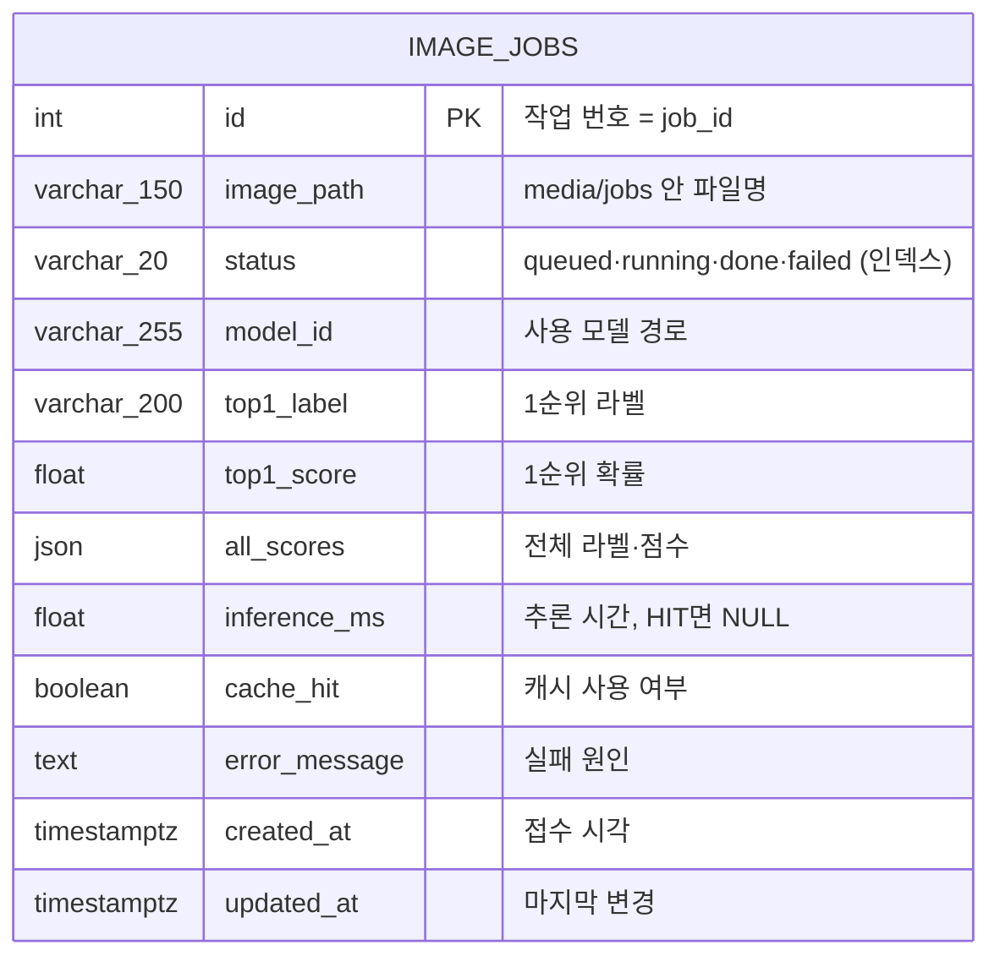
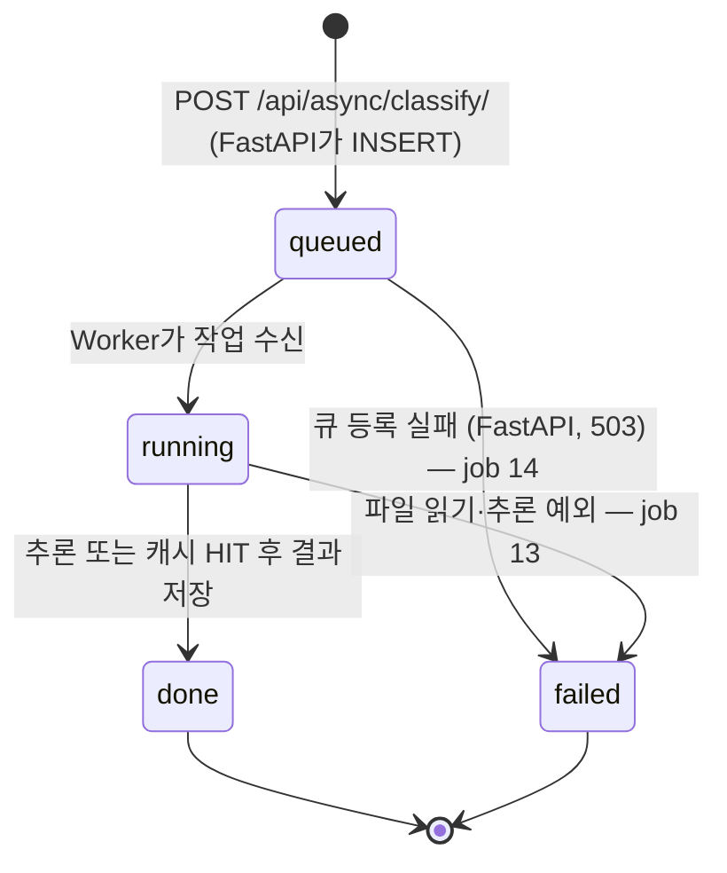

# 산출물 4. DB 구조·작업이력

**테이블명:** `image_jobs` · **PK:** `id` · **저장 대상:** 비동기 추론의 작업 상태와 결과 · PostgreSQL 17 `vision_db` (Docker)

테이블은 FastAPI 시작 시 `Base.metadata.create_all`로 생성된다. 테이블은 하나뿐이며 FK·관계 테이블은 없다. 실제 스키마: [db_schema.txt](evidence/db_schema.txt)



| 컬럼 | DB 자료형 (실제 스키마) | Nullable / 기본 | 예시 값 (이번 실행) | 사용 이유 |
|---|---|---|---|---|
| id | integer, PK, 시퀀스 | NOT NULL | 2 | 고유 작업번호, 응답의 `job_id` |
| image_path | varchar(150) | NOT NULL | `16ff7c91….bin` | 업로드 파일 찾기. 사용자 파일명 대신 UUID |
| status | varchar(20), 인덱스 | NOT NULL, `queued` | done | 처리 상태 |
| model_id | varchar(255) | NOT NULL, `""` | artifacts/beans_resnet18 | 모델 식별 |
| top1_label | varchar(200) | NULL | bean_rust | 최종 분류 라벨 |
| top1_score | double precision | NULL | 0.4297 | 분류 점수 |
| all_scores | json | NULL | 라벨 3개·점수 배열 | 전체 점수 (API 응답에서는 `all`) |
| inference_ms | double precision | NULL | 18.32 | 실제 추론시간. 캐시 HIT면 NULL |
| cache_hit | boolean | NULL | false | 캐시 재사용 여부 |
| error_message | text | NULL | `FileNotFoundError: …` (job 13) | 실패 원인 (최대 1,500자) |
| created_at | timestamptz | NOT NULL, UTC 현재 | 접수 시각 | 생성 시점 |
| updated_at | timestamptz | NOT NULL, 갱신 시 변경 | 처리 완료 시각 | 갱신 시점 |

## 조회 SQL

```sql
SELECT id, status, image_path, model_id, top1_label, top1_score,
       inference_ms, cache_hit, created_at, updated_at
FROM image_jobs
ORDER BY id DESC
LIMIT 10;
```

실행: `docker compose exec postgres psql -U vision_user -d vision_db -c "<SQL>"`. 증빙은 전체 행을 보려고 `ORDER BY id`로 조회하고 `top1_score` 소수 4자리, `error_message` 앞 60자만 표시했다.

## 조회 결과 (2026-11-04, [db_image_jobs.txt](evidence/db_image_jobs.txt))

```text
$ SELECT ... FROM image_jobs ORDER BY id  (2026-11-04 12:14:39 +0900)
 id | status |              image_path              |         model_id         |    top1_label     | top1_score | inference_ms | cache_hit |                        error_message                         |          created_at           |          updated_at           
----+--------+--------------------------------------+--------------------------+-------------------+------------+--------------+-----------+--------------------------------------------------------------+-------------------------------+-------------------------------
  1 | done   | 8147b940ac16401591718c808bbdea30.bin | artifacts/beans_resnet18 | healthy           |     0.4339 |      2739.24 | f         |                                                              | 2026-11-04 03:10:21.328018+00 | 2026-11-04 03:10:24.149655+00
  2 | done   | 16ff7c918bfb42fd8f4db8ac158b7607.bin | artifacts/beans_resnet18 | bean_rust         |     0.4297 |        18.32 | f         |                                                              | 2026-11-04 03:10:24.283249+00 | 2026-11-04 03:10:24.313906+00
  3 | done   | 66a3644c5a214096ba7b58152628f702.bin | artifacts/beans_resnet18 | healthy           |     0.7168 |        19.06 | f         |                                                              | 2026-11-04 03:10:24.400955+00 | 2026-11-04 03:10:24.431461+00
  4 | done   | 106ca451fada47a5beca2d1cc5cb626b.bin | artifacts/beans_resnet18 | bean_rust         |     0.4478 |        19.76 | f         |                                                              | 2026-11-04 03:10:24.519611+00 | 2026-11-04 03:10:24.551034+00
  5 | done   | 83591ddf1ce54a40b40f362274957ba2.bin | artifacts/beans_resnet18 | healthy           |     0.4930 |        18.85 | f         |                                                              | 2026-11-04 03:10:24.639222+00 | 2026-11-04 03:10:24.669638+00
  6 | done   | 75e15cd0530944c0abc1fda8cffe0275.bin | artifacts/beans_resnet18 | healthy           |     0.7436 |        17.75 | f         |                                                              | 2026-11-04 03:10:24.754035+00 | 2026-11-04 03:10:24.783954+00
  7 | done   | 6697ac96a4dc49de99c8dc7fe362e817.bin | artifacts/beans_resnet18 | bean_rust         |     0.4297 |              | t         |                                                              | 2026-11-04 03:10:24.870447+00 | 2026-11-04 03:10:24.87989+00
  8 | done   | ebdc2c5adae64a9faa47ba3c21844ede.bin | artifacts/beans_resnet18 | healthy           |     0.7168 |              | t         |                                                              | 2026-11-04 03:10:24.985111+00 | 2026-11-04 03:10:24.993983+00
  9 | done   | 74850351dba94222b8191323c152f05c.bin | artifacts/beans_resnet18 | bean_rust         |     0.4478 |              | t         |                                                              | 2026-11-04 03:10:25.102904+00 | 2026-11-04 03:10:25.112883+00
 10 | done   | c6cb71eb32864a4f8e7c0c93532d3bd7.bin | artifacts/beans_resnet18 | healthy           |     0.4930 |              | t         |                                                              | 2026-11-04 03:10:25.222578+00 | 2026-11-04 03:10:25.232299+00
 11 | done   | 12601798ba564d01b25ba9ab6c97687a.bin | artifacts/beans_resnet18 | healthy           |     0.7436 |              | t         |                                                              | 2026-11-04 03:10:25.338988+00 | 2026-11-04 03:10:25.348386+00
 12 | done   | 802761615a3d4a96ad5424c707707760.bin | artifacts/beans_resnet18 | healthy           |     0.8513 |      2808.34 | f         |                                                              | 2026-11-04 03:10:42.916718+00 | 2026-11-04 03:13:24.872015+00
 13 | failed | 21ee240c252a4379a800b1acfb1a52f4.bin | artifacts/beans_resnet18 |                   |            |              |           | FileNotFoundError: [Errno 2] No such file or directory: '/ho | 2026-11-04 03:10:42.930755+00 | 2026-11-04 03:13:24.882771+00
 14 | failed | c7fcfda54b1b416881f6e65856a831ac.bin | artifacts/beans_resnet18 |                   |            |              |           | 작업 큐 등록 실패: Redis 연결을 확인하세요.                  | 2026-11-04 03:13:43.478647+00 | 2026-11-04 03:13:44.085234+00
 15 | done   | f0f6b42c4bef49a5a38abacd266554f5.bin | artifacts/beans_resnet18 | bean_rust         |     0.4256 |        20.36 | f         |                                                              | 2026-11-04 03:13:52.558095+00 | 2026-11-04 03:13:52.596847+00
 16 | done   | 7c31ef9696034b588b86ed84efd5e891.bin | artifacts/beans_resnet18 | angular_leaf_spot |     0.5673 |        21.05 | f         |                                                              | 2026-11-04 03:14:13.605422+00 | 2026-11-04 03:14:13.642357+00
(16 rows)

 status | cache_hit | count 
--------+-----------+-------
 done   | f         |     9
 done   | t         |     5
 failed |           |     2
(3 rows)
```

| id | status | cache_hit | 판정 |
|---|---|---|---|
| 1 | done | false | 워밍업 — Worker 첫 작업이라 모델 로딩 포함 `inference_ms` 2,739 |
| 2~6 | done | false | 처음 보낸 Validation 이미지 5장, 실제 추론 (17.8~19.8 ms) |
| 7~11 | done | true | 2~6과 같은 파일 재접수 → 캐시 재사용, `inference_ms` NULL. 작업마다 파일은 새 `image_path`로 저장 |
| 12 | done | false | Worker 정지 중 접수(T-10) → 재시작 후 처리. 새 프로세스라 모델 재로딩 2,808 ms |
| 13 | **failed** | NULL | Worker 정지 중 접수 후 업로드 파일 삭제(T-16) → `FileNotFoundError` 기록 |
| 14 | **failed** | NULL | Redis 정지 중 접수(T-15) → 큐 등록 실패, FastAPI가 `failed` + 503 |
| 15 | done | false | Redis 재시작 후 접수 → Worker 재연결 확인 |
| 16 | done | false | 화면 캡처용 비동기 요청 ([ui_async_done.png](evidence/ui_async_done.png)) |

## 상태 전이



- 관찰: 0.1초 간격 조회에서 job 1은 `queued → running → done`. 나머지는 Worker 처리(약 30 ms)가 조회 간격보다 짧아 `queued → done`만 보임 — `running`을 못 봐도 최종 결과·DB·Worker 로그로 정상 처리 확인
- 이미지 실제 저장 위치: `media/jobs/<uuid>.bin` (DB에는 원본 바이너리를 저장하지 않음)
- 동기 요청은 DB 행을 만들지 않음 (제공 코드 기본 동작)
- 이전 02 방식 실행의 13행은 [docker_mode_02/image_jobs_dump.sql](evidence/docker_mode_02/image_jobs_dump.sql)로 백업한 뒤 테이블을 비우고 다시 시작했다 (`TRUNCATE … RESTART IDENTITY`)
