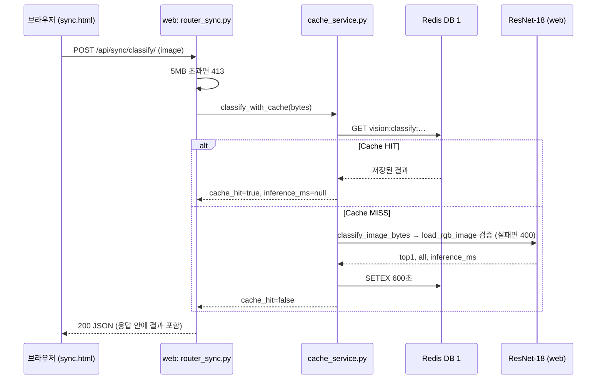
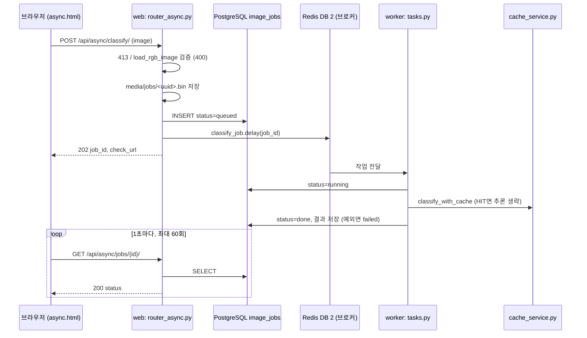
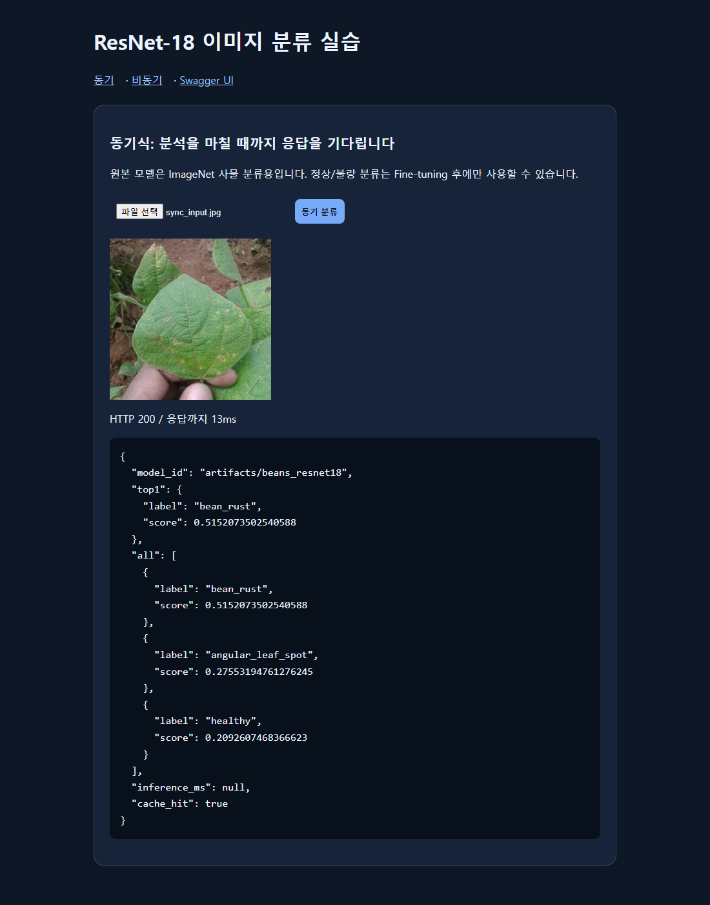
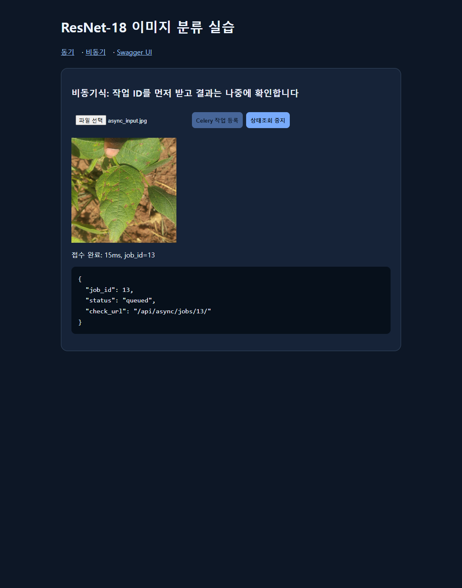
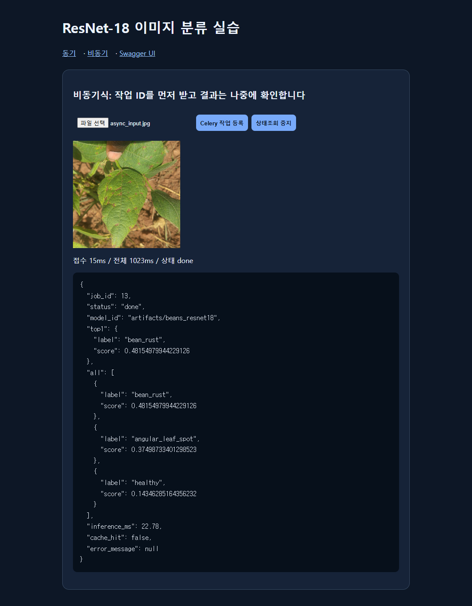

# 산출물 5. AI 버튼 처리흐름

화면: `/vision/sync/`(`templates/sync.html`), `/vision/async/`(`templates/async.html`). 두 화면 모두 같은 ResNet-18 체크포인트(`artifacts/beans_resnet18`)를 쓴다.

## A. 동기 버튼

실측 (2026-11-04): MISS 중앙값 20.4 ms(추론 14.7 ms), HIT 중앙값 1.9 ms. 응답을 받는 순간 결과가 있다.

## B. 비동기 버튼

실측: 접수 HTTP 중앙값 9.9 ms. 측정 스크립트는 0.1초 간격으로 조회해 최종 확인까지 120.7 ms였다. **화면(async.html)은 1초 간격으로 조회**하므로 화면에서 보이는 완료 시간은 최소 1초 이상이다.

## 코드 연결표

| 단계 | 파일 | 함수·처리 | 다음 단계 |
|---|---|---|---|
| S1 | `templates/sync.html` | 버튼 → `fetch('/api/sync/classify/', POST)` | S2 |
| S2 | `ai/router_sync.py` | `classify_sync` — 5MB 검사(413) | S3 |
| S3 | `ai/cache_service.py` | `classify_with_cache` — Redis GET, HIT면 반환 | MISS면 S4 |
| S4 | `ai/services.py` | `classify_image_bytes` → `load_rgb_image`(400) → `get_classifier()(image, top_k=5)` | S5 |
| S5 | `ai/hf_model.py` | `get_classifier` — 프로세스당 1회 `pipeline("image-classification")` 로드 | S3로 돌아가 SETEX 후 응답 |
| A1 | `templates/async.html` | 버튼 → POST, 202면 `check_url`을 1초마다 조회 | A2 |
| A2 | `ai/router_async.py` | `enqueue_classify` — 413·400 검사, 파일 저장, `ImageJob` INSERT, `classify_job.delay` (실패 시 failed+503) | A3 |
| A3 | `ai/celery_app.py` | 브로커 DB 2, 결과 DB 3, JSON 직렬화 | A4 |
| A4 | `ai/tasks.py` | `classify_job` — running → `classify_with_cache` → done/failed | S3·S4 재사용 |
| A5 | `ai/router_async.py` | `get_job` — DB 조회, done일 때만 결과 공개, 없으면 404 | 화면 갱신 |

## 화면 캡처 (2026-11-04)

설치된 Chrome을 Playwright로 헤드리스 실행해 **실제로 파일을 고르고 버튼을 눌러** 찍음 (`bean_rust_test.14.jpg` → 동기, `angular_leaf_spot_test.14.jpg` → 비동기, 둘 다 처음 보내는 파일).

| 화면 | 상태 표시 | 결과 |
|---|---|---|
| 동기, 첫 요청 | `HTTP 200 / 응답까지 57ms` | bean_rust 0.515 (정답), `inference_ms` 28.52, `cache_hit` false |
| 동기, 같은 파일 다시 | `HTTP 200 / 응답까지 13ms` | `cache_hit` true, `inference_ms` null |
| 비동기, 접수 직후 | `접수 완료: 15ms, job_id=13` | 202 응답 JSON |
| 비동기, 완료 | `접수 15ms / 전체 1023ms / 상태 done` | bean_rust 0.482 — **정답 angular_leaf_spot과 다름 (오분류)** |

화면 시간은 브라우저 `performance.now()` 기준이라 [산출물 6](06_성능비교_보고서.md)의 스크립트 측정값과 다르다. 비동기 전체 1023 ms는 화면이 1초 간격으로 조회하기 때문.

