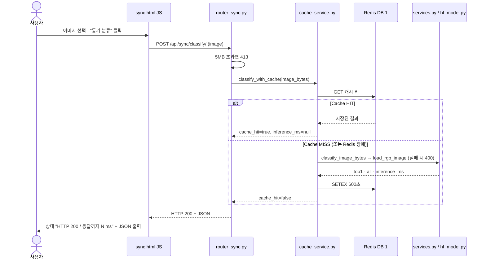
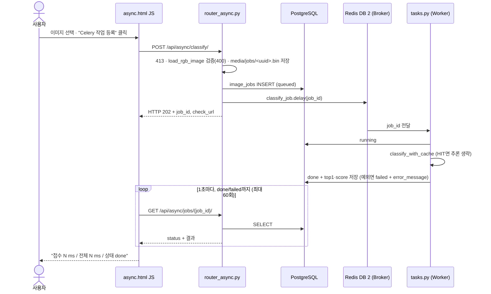

# 산출물 5. AI 버튼 처리흐름

화면: `/vision/sync/` (`templates/sync.html`), `/vision/async/` (`templates/async.html`). 두 경로 모두 같은 체크포인트 `artifacts/beans_resnet18`을 쓰고, 모델은 FastAPI와 Worker 프로세스에 각각 올라간다.

## A. 동기 버튼 클릭 시퀀스

실측: MISS 중앙값 22.8 ms (추론 18.0 ms), HIT 1.7 ms. 응답을 받는 순간 결과가 있다.

## B. 비동기 버튼 클릭 시퀀스

실측: 접수 중앙값 8.5 ms. 측정 스크립트(0.1초 조회) 기준 최종 확인 117.1 ms. 화면은 1초 간격 조회라 완료 표시가 최소 1초 뒤다.

## 실제 코드 연결표

| 단계 | 시작 파일 | 핵심 함수·처리 | 반환 / 다음 단계 |
|---|---|---|---|
| 동기 1 | `templates/sync.html` | 버튼 → `fetch('/api/sync/classify/', POST)` | 동기 2 |
| 동기 2 | `ai/router_sync.py` | `classify_sync()` — 5MB 검사(413) | `classify_with_cache()` |
| 동기 3 | `ai/cache_service.py` | `classify_with_cache()` — Redis GET, HIT면 반환 | MISS면 동기 4 |
| 동기 4 | `ai/services.py` | `load_rgb_image()`(400) · `get_classifier()(image, top_k=5)` | `top1`, `all`, `inference_ms` |
| 동기 5 | `ai/hf_model.py` | `get_classifier()` — 프로세스당 1회 `pipeline("image-classification", device=-1)` | 동기 3으로 돌아가 SETEX 후 200 |
| 비동기 1 | `templates/async.html` | 버튼 → POST, 202면 `check_url`을 1초마다 조회 | 비동기 2 |
| 비동기 2 | `ai/router_async.py` | `enqueue_classify()` — 413·400 검사, 파일 저장, `ImageJob` INSERT, `classify_job.delay()` (실패 시 `failed` + 503) | DB `queued`, 202 |
| 비동기 3 | `ai/celery_app.py` | 브로커 DB 2, 결과 DB 3, JSON 직렬화 | Worker |
| 비동기 4 | `ai/tasks.py` | `classify_job()` — running → `classify_with_cache()` → done / failed | 동기 3·4 재사용 |
| 비동기 5 | `ai/router_async.py` | `get_job()` — DB 조회, 없으면 404 | 상태·예측 JSON |

## 화면 캡처 (2026-11-04, 가이드 방식 실행)

`scripts/capture_ui.py`로 설치된 Chrome을 헤드리스로 띄워 **실제로 파일을 고르고 버튼을 눌러** 찍었다. 이미지는 Validation `bean_rust_val.19.jpg`(동기), `angular_leaf_spot_val.19.jpg`(비동기) — 둘 다 처음 보내는 파일.

| 화면 | 상태 표시 | 결과 |
|---|---|---|
| 동기 첫 요청 | `HTTP 200 / 응답까지 71ms` | bean_rust 0.527 (정답), `cache_hit` false |
| 동기 같은 파일 재요청 | `HTTP 200 / 응답까지 48ms` | `cache_hit` true, `inference_ms` null |
| 비동기 접수 | `접수 완료: 14ms, job_id=16` | 202 JSON |
| 비동기 완료 | `접수 14ms / 전체 1038ms / 상태 done` | angular_leaf_spot 0.567 (정답) |

화면 시간은 브라우저 `performance.now()` 기준(JSON 출력·이미지 미리보기 포함)이라 [산출물 6](06_성능비교_보고서.md)의 스크립트 측정값과 다르다.

