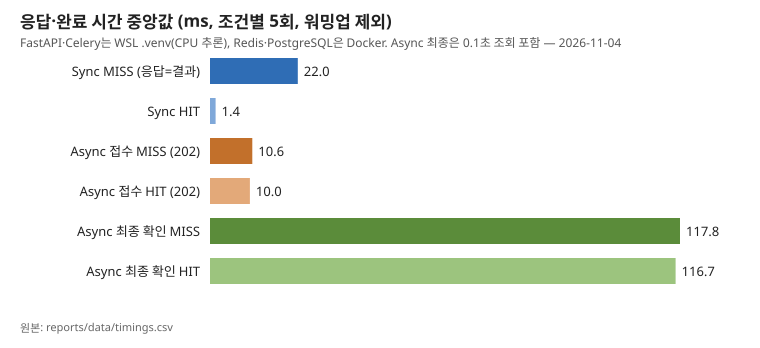
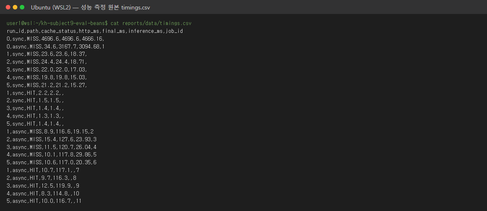
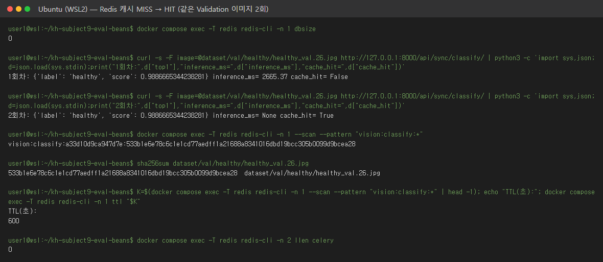

# 산출물 6. 성능비교 보고서

## 1. 실험 조건

| 조건 | 값 |
|---|---|
| 이미지 | `dataset/val`의 서로 다른 JPG 12장 (워밍업 2 + Sync 5 + Async 5), 모두 500×500. HIT 그룹은 MISS 그룹과 **같은 파일** 재전송. 파일 해시는 아래 표. **Test split은 쓰지 않음** |
| 모델 | `artifacts/beans_resnet18_full` (최종 선정 E2 Full FT) — FastAPI·Worker 같은 체크포인트. E0 서비스 측정값과 비교는 [산출물 1 §6-2](01_FineTuning_결과보고서.md) |
| 실행환경 | FastAPI·Celery: WSL2 `.venv` (Python 3.11.17), **CPU 추론**. Redis·PostgreSQL: Docker. i7-12700. 요청은 같은 WSL에서 `127.0.0.1:8000` |
| 반복 | 조건별 5회, 순차 요청 (동시 요청 없음) |
| 캐시 구분 | 측정 전 Redis DB 1 비움 (`FLUSHDB`, 이전 키 0개) → 처음 보내는 파일 = MISS, 같은 파일 재전송 = HIT. 응답 `cache_hit`으로 매 요청 확인, 어긋나면 스크립트 중단 |
| Worker | solo, concurrency=1 |
| 워밍업 | 프로세스별 첫 요청(run_id 0)은 모델 로딩 포함 → 따로 기록, 비교 제외 |
| 시간 정의 | `http_ms` = 요청 전송~응답 수신 (`time.perf_counter`). `final_ms` = Async 접수 요청 시작~`done`을 받은 조회 응답. **조회 간격 0.1초** (브라우저 화면은 1초 — 이 값은 화면 캡처에만 반영) |
| 도구 | `scripts/bench_api.py` (httpx), 2026-11-04T12:51:31+09:00 |

측정 이미지 (MISS 그룹 + 워밍업):

| run_id | 경로 | 파일 | 바이트 | SHA-256 앞 16자 |
|---:|---|---|---:|---|
| 0 | sync | `val/angular_leaf_spot/angular_leaf_spot_val.0.jpg` | 154,989 | `0ed3b17803cc701f…` |
| 0 | async | `val/bean_rust/bean_rust_val.0.jpg` | 123,942 | `76e4dcf4fe49a9c0…` |
| 1 | sync | `val/healthy/healthy_val.0.jpg` | 167,703 | `dfd5a598b509ca4d…` |
| 2 | sync | `val/angular_leaf_spot/angular_leaf_spot_val.1.jpg` | 128,762 | `288db8fc386074f4…` |
| 3 | sync | `val/bean_rust/bean_rust_val.1.jpg` | 114,625 | `88e48fe71c68e18b…` |
| 4 | sync | `val/healthy/healthy_val.1.jpg` | 109,726 | `aef220a6b3d1b560…` |
| 5 | sync | `val/angular_leaf_spot/angular_leaf_spot_val.10.jpg` | 180,514 | `8df4001ed9074702…` |
| 1 | async | `val/bean_rust/bean_rust_val.10.jpg` | 125,317 | `4a1276a774d907e4…` |
| 2 | async | `val/healthy/healthy_val.10.jpg` | 155,739 | `6a423ee493d762cd…` |
| 3 | async | `val/angular_leaf_spot/angular_leaf_spot_val.11.jpg` | 172,044 | `68a9cc5b7c7c0047…` |
| 4 | async | `val/bean_rust/bean_rust_val.11.jpg` | 132,144 | `e1b2be8cb5530535…` |
| 5 | async | `val/healthy/healthy_val.11.jpg` | 160,384 | `546708fceffcf9cc…` |

## 2. 원본 측정표 (`data/timings.csv`)

모두 ms. 워밍업(run_id 0, 비교 제외): Sync MISS 4696.6 (추론 4666.16), Async 접수 34.6 / 최종 3167.7 (추론 3094.68).

| 반복 | Sync HTTP·전체 MISS | Sync HTTP HIT | Async 접수 MISS | Async 최종 MISS | Async 접수 HIT | Async 최종 HIT |
|---:|---:|---:|---:|---:|---:|---:|
| 1 | 23.6 | 2.2 | 8.9 | 116.6 | 10.7 | 117.1 |
| 2 | 24.4 | 1.5 | 15.4 | 127.6 | 9.7 | 116.3 |
| 3 | 22.0 | 1.4 | 11.5 | 120.7 | 12.5 | 119.9 |
| 4 | 19.8 | 1.3 | 10.1 | 117.8 | 8.3 | 114.8 |
| 5 | 21.2 | 1.4 | 10.6 | 117.0 | 10.0 | 116.7 |
| **중앙값** | **22.0** | **1.4** | **10.6** | **117.8** | **10.0** | **116.7** |
| 범위 | 19.8~24.4 | 1.3~2.2 | 8.9~15.4 | 116.6~127.6 | 8.3~12.5 | 114.8~119.9 |

모델 추론 시간 `inference_ms` (MISS만, HIT는 모두 null):

| 반복 | Sync MISS 추론 | Async MISS 추론 |
|---:|---:|---:|
| 1 | 18.37 | 19.15 |
| 2 | 18.71 | 23.93 |
| 3 | 17.03 | 26.04 |
| 4 | 15.03 | 29.86 |
| 5 | 15.27 | 20.35 |
| **중앙값** | **17.0** | **23.9** |

```csv
run_id,path,cache_status,http_ms,final_ms,inference_ms,job_id
0,sync,MISS,4696.6,4696.6,4666.16,
0,async,MISS,34.6,3167.7,3094.68,1
1,sync,MISS,23.6,23.6,18.37,
2,sync,MISS,24.4,24.4,18.71,
3,sync,MISS,22.0,22.0,17.03,
4,sync,MISS,19.8,19.8,15.03,
5,sync,MISS,21.2,21.2,15.27,
1,sync,HIT,2.2,2.2,,
2,sync,HIT,1.5,1.5,,
3,sync,HIT,1.4,1.4,,
4,sync,HIT,1.3,1.3,,
5,sync,HIT,1.4,1.4,,
1,async,MISS,8.9,116.6,19.15,2
2,async,MISS,15.4,127.6,23.93,3
3,async,MISS,11.5,120.7,26.04,4
4,async,MISS,10.1,117.8,29.86,5
5,async,MISS,10.6,117.0,20.35,6
1,async,HIT,10.7,117.1,,7
2,async,HIT,9.7,116.3,,8
3,async,HIT,12.5,119.9,,9
4,async,HIT,8.3,114.8,,10
5,async,HIT,10.0,116.7,,11
```



## 3. 캐시 비교

| 경로 | 캐시 | HTTP 응답 중앙값 (ms) | 추론시간 중앙값 (ms) | 메모 |
|---|---|---:|---:|---|
| 동기 | MISS | 22.0 | 17.0 | 모델 실제 추론, 응답에 결과 포함 |
| 동기 | HIT | 1.4 | null | 추론 생략 |
| 비동기 | MISS | 10.6 (접수) | 23.9 | 최종 확인 117.8 |
| 비동기 | HIT | 10.0 (접수) | null | 최종 확인 116.7 |

```text
동기 캐시 효과        = (22.0 - 1.4) / 22.0 × 100 = 93.64%   (같은 파일, MISS 대 HIT)
HTTP 응답 감소율      = (22.0 - 10.6) / 22.0 × 100 = 51.82%   (Sync MISS 대 Async 접수 MISS)
결과 확인까지의 차이  = 117.8 - 22.0 = 95.8 ms   (비동기가 더 늦게 결과 확인)
```

## 4. 해석

- 동기 HIT는 MISS보다 93.64% 빨랐다. 이미지 디코딩·추론을 건너뛰기 때문이다. HIT의 `inference_ms=null`은 0ms가 아니라 **추론을 하지 않았다**는 뜻이다.
- 비동기 접수(202)는 동기 MISS보다 51.82% 빨리 돌아왔다. **모델이 빨라진 것이 아니라** 요청 접수와 추론을 분리한 효과다. 접수에도 이미지 검증·파일 저장·DB INSERT·큐 등록이 있어 약 10.6 ms가 든다.
- 결과 확인은 비동기가 95.8 ms 늦었다. 대부분 **0.1초 조회 간격** 때문이다. DB 기록상 Worker 처리 자체는 MISS 약 30~45 ms, HIT 약 10 ms ([산출물 4](04_DB_구조_작업이력.md)). 그래서 비동기에서는 MISS·HIT 최종 시간 차이(117.8 대 116.7)가 조회 간격에 묻힌다.
- 이 PC에서 MISS 추론은 약 17.0 ms(CPU)로 짧아 동기 대기도 짧다. 비동기의 이점(웹 요청이 추론을 기다리지 않음)은 추론이 길거나 요청이 몰릴 때 커질 것으로 **예상**하지만 동시 요청·부하 시험은 하지 않았다 (미측정).
- 워밍업: 프로세스별 첫 요청은 모델 로딩으로 약 2.8~4.7초. Worker 재시작 뒤에도 다시 발생 (job 12, 2,826 ms).

## 5. 비교 조건 점검

- [x] 같은 모델 체크포인트 — 모든 응답 `model_id = artifacts/beans_resnet18_full`
- [x] MISS 대 MISS, HIT 대 HIT — 응답 `cache_hit`으로 매 요청 확인
- [x] 같은 하드웨어·조건 — 같은 PC, 같은 프로세스, 연속 실행, 같은 해상도 500×500
- [x] 첫 로딩·워밍업 처리 표기 — run_id 0 별도, 비교 제외
- [x] 원본값과 요약표 일치 — 중앙값은 `timings.csv`에서 스크립트로 계산
- 한계: Sync와 Async MISS는 서로 다른 이미지 5장씩(크기 같음) — 같은 파일이면 한쪽이 HIT가 되므로 나눔. 5회·순차·단일 PC

## 부록. 제공 문서 02 방식(전부 Docker)과 비교

같은 코드를 02 방식(FastAPI·Celery도 컨테이너, CPU PyTorch 2.5.1)으로 먼저 실행한 측정 ([docker_mode_02/timings.csv](data/docker_mode_02/timings.csv), Test 이미지 사용 — [E-05](07_기능테스트_오류분석.md)). 이미지·환경이 달라 **직접 비교 근거로 쓰지 않고** 경향만 참고한다.

| 중앙값 (ms) | 가이드 방식 (.venv) | 02 방식 (Docker) |
|---|---:|---:|
| Sync MISS | 22.0 | 20.4 |
| Sync HIT | 1.4 | 1.9 |
| Async 접수 MISS | 10.6 | 9.9 |
| Async 최종 MISS | 117.8 | 120.7 |

두 방식 모두 "HIT ≪ MISS", "비동기 접수 < 동기 MISS < 비동기 최종 확인" 순서가 같았다.
## 6. 추가 측정: 사진 10장을 한꺼번에 보낼 때

위 측정은 한 번에 한 장이다. 실제 화면도 한 번에 한 장만 고를 수 있어서(`<input type="file">`에 `multiple` 없음), "비동기도 결국 한 장씩 아니냐"를 확인하려고 10장을 몰아서 보냈다. 스크립트 `scripts/burst_api.py` (2026-11-05 10:32).

- 같은 Validation 10장(클래스 번갈아, 앞의 측정·캡처에 안 쓴 파일), 매 조건 전 캐시 비움 → 10장 모두 MISS
- **연속**: 한 장 응답을 받고 다음 장 (버튼을 빠르게 10번 누르는 경우)
- **동시**: 10장을 스레드 10개로 같은 순간에 (사용자 10명이 동시에 누르는 경우)
- Worker는 제공 명령 그대로 `--pool=solo --concurrency=1` (한 번에 1개 처리). 동기 경로는 FastAPI 스레드풀에서 여러 요청이 동시에 실행됨
- 조건별 3회 반복, 중앙값. 비동기 결과 조회 간격 0.1초. DB 작업 31~90번이 이 측정

| 조건 (ms, 중앙값) | 요청 1개 응답 | 10개 모두 응답 받음 | 10개 모두 결과 확인 | 접수 직후 큐 길이 |
|---|---:|---:|---:|---:|
| 연속 · 동기 | 40.5 | 407.1 | 407.1 (응답 = 결과) | — |
| 연속 · 비동기 | 10.4 (202) | 103.9 | 370.1 | 6 |
| 동시 · 동기 | 135.6 | 144.0 | 144.0 (응답 = 결과) | — |
| 동시 · 비동기 | 60.3 (202) | 75.3 | 485.8 | 9 |

해석:
- **연속**: 비동기는 10장을 104 ms 만에 모두 접수했다. 동기는 한 장씩 결과를 기다려 407 ms. 보내는 쪽이 손을 놓는 시점이 약 3.9배 빨랐다. 최종 결과까지는 비동기 370 ms로 비슷하다 (Worker가 접수 중에도 앞 작업부터 처리).
- **동시**: 동기가 10장 결과를 144 ms에 모두 돌려줘 비동기 최종(486 ms)보다 빨랐다. FastAPI가 스레드로 10장을 같이 판정한 반면, Worker는 1개라 큐에서 하나씩 처리하기 때문이다 (Worker 추론 합계 약 183 ms). 비동기는 접수만 빨랐다.
- **비교 조건의 차이 (중요)**: 동기 경로 함수는 `def classify_sync`(일반 함수)라 FastAPI가 스레드풀(기본 최대 40개)에서 여러 요청을 동시에 실행한다. 동시·동기 10장의 응답이 중앙값 136 ms, 최대 140 ms로 거의 같은 시점에 끝난 것이 그 증거다 (한 장씩이었다면 마지막 장은 약 10 × 22 ms 뒤에 끝났어야 함). 반면 비동기는 제공 명령대로 Worker 1개·concurrency 1이다. 따라서 이 결과는 '동기가 원래 더 빠르다'가 아니라 **이 설정에서 동시에 판정할 수 있는 개수가 달랐다**는 뜻이다. Worker concurrency를 늘린 비교와, 판정이 길 때 동기 요청이 스레드를 모두 차지해 다른 요청까지 막히는 상황은 측정하지 않았다.
- 큐 길이 6~9: 접수 직후 Redis 큐에 작업이 쌓여 있다가 Worker가 순서대로 꺼낸 것을 보여 준다.
- 결론: 이 설정(Worker 1개, 판정 약 18 ms)에서 비동기는 **처리량을 늘리지 않고, 요청을 받는 쪽을 빨리 풀어 줄 뿐**이다. 처리량을 늘리려면 Worker 수·`--concurrency`를 늘려야 하며 이는 측정하지 않았다.
- 한계: 같은 PC에서 보내고 받음, 반복 3회라 흔들림이 있다 (연속·동기 10장 전체: 229.2, 407.1, 418.7 ms). 원본: [burst_10.csv](data/burst_10.csv), [burst_10_summary.json](data/burst_10_summary.json)


## 실행 캡처

터미널 캡처는 실제 명령과 그 출력(`evidence/screens/src/*.txt`)을 `scripts/render_screens.py`로 PNG로 옮긴 것이다. 브라우저 캡처는 헤드리스 Chrome으로 실제 페이지를 찍었다.

**성능 측정 원본 `timings.csv`**



**Redis 캐시 MISS → HIT 실시간 확인 (키 = 모델 해시 + 이미지 SHA-256, TTL 600초). 서버 재시작 직후라 1회차는 워밍업 포함**



