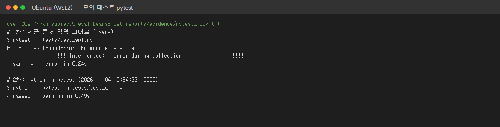
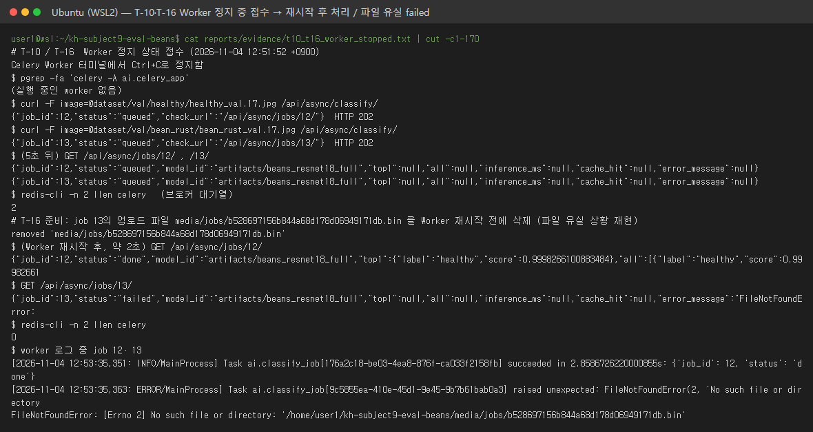
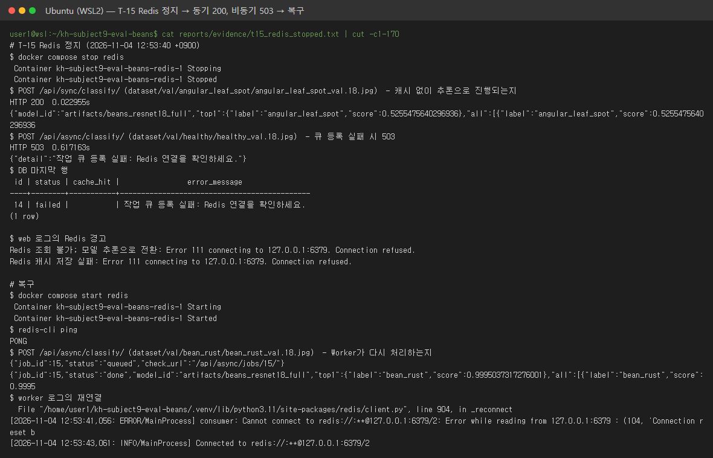
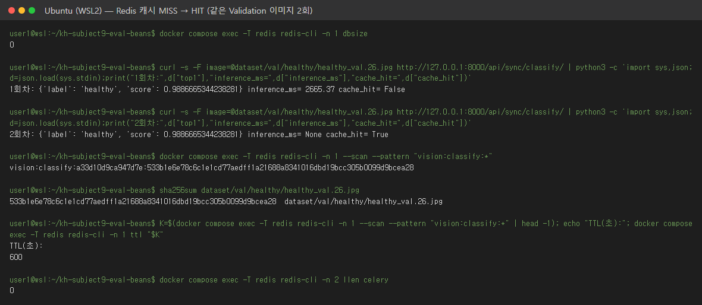
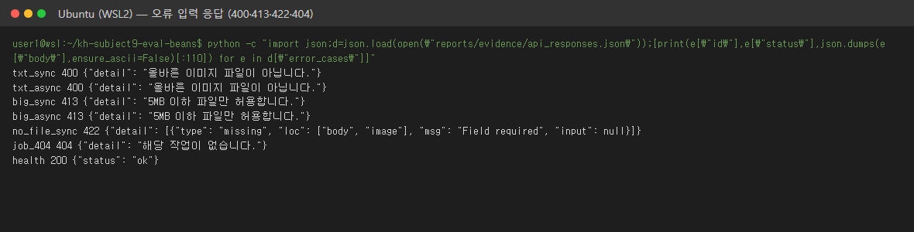

# 산출물 7. 기능테스트·오류분석

실행일 2026-11-04. 실제 ResNet-18 + Redis + PostgreSQL + Celery를 **평가 가이드 구조**(FastAPI·Celery는 `.venv`, Redis·PostgreSQL은 Docker)로 띄운 **실환경 통합 테스트**와, 가짜 모델을 쓰는 **모의 테스트**를 나눠 적는다.

## 테스트 기록

| Test ID | 확인 항목 | 입력·절차 | 기대 결과 | 실제 결과 | 판정 | 증빙 |
|---|---|---|---|---|---|---|
| T-01 | FastAPI 헬스 | GET `/health` | 200 / ok | 200 / ok | PASS | [environment_and_status.txt](evidence/environment_and_status.txt) |
| T-02 | 모델 동기 추론 | Validation JPG 5장 | 200 / 3클래스 JSON | 200 ×5 | PASS | [api_responses.json](evidence/api_responses.json) |
| T-03 | 비동기 접수 | Validation JPG 5장 | 202 / job_id | 202 ×5 / job 2~6 | PASS | 같은 파일 |
| T-04 | 비동기 완료 | GET `/api/async/jobs/{id}/` | 200 / done | 200 / 모두 done | PASS | 같은 파일 |
| T-05 | Redis 연결 | `redis-cli ping` | PONG | PONG | PASS | environment_and_status.txt |
| T-06 | DB 기록 | `image_jobs` 조회 | 접수 1건당 1행 | 16행 (done 14, failed 2) | PASS | [db_image_jobs.txt](evidence/db_image_jobs.txt) |
| T-07 | 불량 입력 | `.txt` 업로드 (sync / async) | 400 | 400 / 400 | PASS | api_responses.json `error_cases` |
| T-08 | 없는 작업번호 | GET `/api/async/jobs/999999/` | 404 | 404 | PASS | 같은 파일 |
| T-09 | 캐시 반복 | 같은 파일 2회 (sync 5쌍, async 5쌍) | MISS → HIT | 10쌍 모두 MISS → HIT, HIT `inference_ms` null | PASS | api_responses.json, timings.csv |
| T-10 | Worker 미실행 | Worker 터미널 Ctrl+C → 접수 → 5초 대기 → Worker 재실행 | queued 유지 → 재시작 후 처리 | 202 → 5초 뒤 queued, 대기열 2 → 재시작 후 job 12 done, 대기열 0 | PASS | [t10_t16_worker_stopped.txt](evidence/t10_t16_worker_stopped.txt) |
| T-11 | 업로드 한도 | 6MB 파일 (sync / async) | 413 | 413 / 413 | PASS | api_responses.json |
| T-12 | 필수 필드 누락 | 파일 없이 POST sync | 422 | 422 `Field required` | PASS | 같은 파일 |
| T-13 | 캐시 키 | 측정 후 Redis DB 1 키 개수 (`setex` TTL 600초는 코드 기준) | 키 = 서로 다른 이미지 수 | 키 12개 (측정 이미지 12장) | PASS | api_responses.json `cache_keys_after` |
| T-14 | 모의 테스트 | `python -m pytest -q tests/test_api.py` (.venv) | 4 passed | 4 passed | PASS (모의) | [pytest_mock.txt](evidence/pytest_mock.txt) |
| T-15 | Redis 장애 | `docker compose stop redis` → sync·async 요청 → `start redis` → async | sync는 추론으로 200, async 503 + failed, 복구 후 처리 | sync 200 (`cache_hit` false), async 503 / job 14 failed, 재시작 후 Worker 로그 `Connected to redis`, job 15 done | PASS | [t15_redis_stopped.txt](evidence/t15_redis_stopped.txt) |
| T-16 | Worker 처리 실패 | Worker 정지 중 접수한 job 13의 업로드 파일 삭제 → Worker 재실행 | failed + error_message | failed, `FileNotFoundError: … .bin` | PASS | t10_t16_worker_stopped.txt, [celery_worker_log.txt](evidence/celery_worker_log.txt) |
| T-17 | 화면 버튼 (동기) | `/vision/sync/` 파일 선택 → 동기 분류 2회 | 결과 표시, 2회째 HIT | 200 28ms MISS → 200 45ms HIT | PASS | [ui_sync_miss.png](evidence/ui_sync_miss.png), [ui_sync_hit.png](evidence/ui_sync_hit.png) |
| T-18 | 화면 버튼 (비동기) | `/vision/async/` 파일 선택 → Celery 작업 등록 | 접수 표시 후 done | 접수 53ms, job 16 → 전체 1075ms done | PASS | [ui_async_accepted.png](evidence/ui_async_accepted.png), [ui_async_done.png](evidence/ui_async_done.png) |

T-10 · T-16 원본:

```text
# T-10 / T-16  Worker 정지 상태 접수 (2026-11-04 12:51:52 +0900)
Celery Worker 터미널에서 Ctrl+C로 정지함
$ pgrep -fa 'celery -A ai.celery_app'
(실행 중인 worker 없음)
$ curl -F image=@dataset/val/healthy/healthy_val.17.jpg /api/async/classify/
{"job_id":12,"status":"queued","check_url":"/api/async/jobs/12/"}  HTTP 202
$ curl -F image=@dataset/val/bean_rust/bean_rust_val.17.jpg /api/async/classify/
{"job_id":13,"status":"queued","check_url":"/api/async/jobs/13/"}  HTTP 202
$ (5초 뒤) GET /api/async/jobs/12/ , /13/
{"job_id":12,"status":"queued","model_id":"artifacts/beans_resnet18_full","top1":null,"all":null,"inference_ms":null,"cache_hit":null,"error_message":null}
{"job_id":13,"status":"queued","model_id":"artifacts/beans_resnet18_full","top1":null,"all":null,"inference_ms":null,"cache_hit":null,"error_message":null}
$ redis-cli -n 2 llen celery   (브로커 대기열)
2
# T-16 준비: job 13의 업로드 파일 media/jobs/b528697156b844a68d178d06949171db.bin 를 Worker 재시작 전에 삭제 (파일 유실 상황 재현)
removed 'media/jobs/b528697156b844a68d178d06949171db.bin'
$ (Worker 재시작 후, 약 2초) GET /api/async/jobs/12/
{"job_id":12,"status":"done","model_id":"artifacts/beans_resnet18_full","top1":{"label":"healthy","score":0.9998266100883484},"all":[{"label":"healthy","score":0.9998266100883484},{"label":"angular_leaf_spot","score":9.002030128613114e-05},{"label":"bean_rust","score":8.341872307937592e-05}],"inference_ms":2825.9,"cache_hit":false,"error_message":null}
$ GET /api/async/jobs/13/
{"job_id":13,"status":"failed","model_id":"artifacts/beans_resnet18_full","top1":null,"all":null,"inference_ms":null,"cache_hit":null,"error_message":"FileNotFoundError: [Errno 2] No such file or directory: '/home/user1/kh-subject9-eval-beans/media/jobs/b528697156b844a68d178d06949171db.bin'"}
$ redis-cli -n 2 llen celery
0
$ worker 로그 중 job 12·13
[2026-11-04 12:53:35,351: INFO/MainProcess] Task ai.classify_job[176a2c18-be03-4ea8-876f-ca033f2158fb] succeeded in 2.8586726220000855s: {'job_id': 12, 'status': 'done'}
[2026-11-04 12:53:35,363: ERROR/MainProcess] Task ai.classify_job[9c5855ea-410e-45d1-9e45-9b7b61bab0a3] raised unexpected: FileNotFoundError(2, 'No such file or directory')
FileNotFoundError: [Errno 2] No such file or directory: '/home/user1/kh-subject9-eval-beans/media/jobs/b528697156b844a68d178d06949171db.bin'
```

T-15 원본:

```text
# T-15 Redis 정지 (2026-11-04 12:53:40 +0900)
$ docker compose stop redis
 Container kh-subject9-eval-beans-redis-1 Stopping 
 Container kh-subject9-eval-beans-redis-1 Stopped 
$ POST /api/sync/classify/ (dataset/val/angular_leaf_spot/angular_leaf_spot_val.18.jpg)  — 캐시 없이 추론으로 진행되는지
HTTP 200  0.022955s
{"model_id":"artifacts/beans_resnet18_full","top1":{"label":"angular_leaf_spot","score":0.5255475640296936},"all":[{"label":"angular_leaf_spot","score":0.5255475640296936},{"label":"healthy","score":0.2783240079879761},{"label":"bean_rust","score":0.1961284875869751}],"inference_ms":16.15,"cache_hit":false}
$ POST /api/async/classify/ (dataset/val/healthy/healthy_val.18.jpg)  — 큐 등록 실패 시 503
HTTP 503  0.617163s
{"detail":"작업 큐 등록 실패: Redis 연결을 확인하세요."}
$ DB 마지막 행
 id | status | cache_hit |                error_message                
----+--------+-----------+---------------------------------------------
 14 | failed |           | 작업 큐 등록 실패: Redis 연결을 확인하세요.
(1 row)

$ web 로그의 Redis 경고
Redis 조회 불가; 모델 추론으로 전환: Error 111 connecting to 127.0.0.1:6379. Connection refused.
Redis 캐시 저장 실패: Error 111 connecting to 127.0.0.1:6379. Connection refused.

# 복구
$ docker compose start redis
 Container kh-subject9-eval-beans-redis-1 Starting 
 Container kh-subject9-eval-beans-redis-1 Started 
$ redis-cli ping
PONG
$ POST /api/async/classify/ (dataset/val/bean_rust/bean_rust_val.18.jpg)  — Worker가 다시 처리하는지
{"job_id":15,"status":"queued","check_url":"/api/async/jobs/15/"}
{"job_id":15,"status":"done","model_id":"artifacts/beans_resnet18_full","top1":{"label":"bean_rust","score":0.9995037317276001},"all":[{"label":"bean_rust","score":0.9995037317276001},{"label":"healthy","score":0.00047552952310070395},{"label":"angular_leaf_spot","score":2.0676772692240775e-05}],"inference_ms":21.31,"cache_hit":false,"error_message":null}
$ worker 로그의 재연결
  File "/home/user1/kh-subject9-eval-beans/.venv/lib/python3.11/site-packages/redis/client.py", line 904, in _reconnect
[2026-11-04 12:53:41,056: ERROR/MainProcess] consumer: Cannot connect to redis://:**@127.0.0.1:6379/2: Error while reading from 127.0.0.1:6379 : (104, 'Connection reset by peer').
[2026-11-04 12:53:43,061: INFO/MainProcess] Connected to redis://:**@127.0.0.1:6379/2
```

## 오류 이력

| 오류 ID | 현상 | 원인 | 조치 | 재검증 | 결과 |
|---|---|---|---|---|---|
| E-01 | Redis·PostgreSQL 포트 6379·5432 사용 중 | 같은 PC의 수업 실습 컨테이너 `fastapi_resnet18-redis-1`·`-postgres-1`이 `restart: unless-stopped`로 Docker 시작 시 자동 실행 | 두 컨테이너만 `docker stop` (볼륨 유지). 평가 `compose.yaml` 포트는 그대로 | `docker compose ps` | 정상 기동 |
| E-02 | 제공 문서 명령 `pytest -q tests/test_api.py` → `ModuleNotFoundError: No module named 'ai'` | `pytest` 실행 파일은 테스트 파일 폴더(`tests/`)만 import 경로에 넣고 프로젝트 루트는 넣지 않음 (`tests/`에 `__init__.py`·`conftest.py` 없음). `.venv`와 Docker 모두 같은 현상 | 코드 수정 없이 `python -m pytest`로 실행 (현재 폴더가 경로에 추가됨) | 같은 `.venv`에서 재실행 | 4 passed |
| E-03 | Train zip에 이미지가 아닌 파일 1개 | macOS `.DS_Store` (`healthy_train.120tore`, 시작 바이트 `Bud1`) | 배치 시 제외 | Train 1,034장 = 데이터 카드 | [산출물 1](01_FineTuning_결과보고서.md) |
| E-04 | 처음 학습·평가·측정을 **다른 프로젝트(수업용)의 가상환경**으로 실행 | 저장소만 분리하고 가상환경을 만들지 않음 | 프로젝트 전용 `.venv`(Python 3.11, `requirements.txt`) 생성 → 같은 명령으로 재학습 → 평가·측정·캡처 전부 다시 수행 | 재학습 모델 SHA-256이 이전과 같음 (가중치 차이 0.0) | 모든 수치를 `.venv` 결과로 교체 |
| E-05 | 처음 측정·시연에 **Test 이미지 15장** 사용, 예측 결과를 봄 | 측정용 이미지를 고를 때 split 구분을 안 함 | 측정·캡처를 Validation 이미지로 교체. Test는 모델 선택 뒤 1회 평가만 (`evaluate.py --final`, 실행 기록 남김) | `scripts/bench_api.py` 기본값 `dataset/val` | 모델·설정 선택에는 Test를 쓰지 않음 |
| E-06 | 실행 구조가 평가 가이드와 다름 | 제공 문서 02의 `compose.yaml`(FastAPI·Celery도 컨테이너)만 따름 | `docker compose up -d redis postgres` + `.venv`에서 Celery·uvicorn 별도 터미널 실행 | `docker compose ps`, `ps` 프로세스 경로 | 가이드 구조로 재측정. 02 방식 기록은 [docker_mode_02](evidence/docker_mode_02/)에 보관 |
| O-01 (관찰) | Worker 재시작 후 첫 작업 `inference_ms` 2,826 | 프로세스별 모델 첫 로드 (`lru_cache`) | 오류 아님, 워밍업 | — | 성능 비교 제외 |

## 테스트 구분

- 모의 테스트 (`tests/test_api.py`, 가짜 모델·SQLite): `.venv`에서 `python -m pytest` 4 passed — **실환경 통합 테스트 아님**
- 실환경 통합 테스트: T-01~T-13, T-15~T-18 PASS (가이드 구조). 미실시 항목 없음
- 화면 버튼 테스트 T-17·T-18: 헤드리스 Chrome(Playwright)으로 실제 파일 선택·버튼 클릭. 나머지는 같은 API를 `scripts/bench_api.py`(httpx)·`curl`로 호출

## 실행 캡처

터미널 캡처는 실제 명령과 그 출력(`evidence/screens/src/*.txt`)을 `scripts/render_screens.py`로 PNG로 옮긴 것이다. 브라우저 캡처는 헤드리스 Chrome으로 실제 페이지를 찍었다.

**모의 테스트 (`pytest` 실패 → `python -m pytest` 4 passed)**



**T-10·T-16 Worker 정지 중 접수 → 재시작 후 처리 / 파일 유실 시 failed**



**T-15 Redis 정지 → 동기 200·비동기 503 → 복구**



**Redis 캐시 MISS → HIT 실시간 확인 (키 = 모델 해시 + 이미지 SHA-256, TTL 600초). 서버 재시작 직후라 1회차는 워밍업 포함**



**오류 입력 응답 400·413·422·404**



