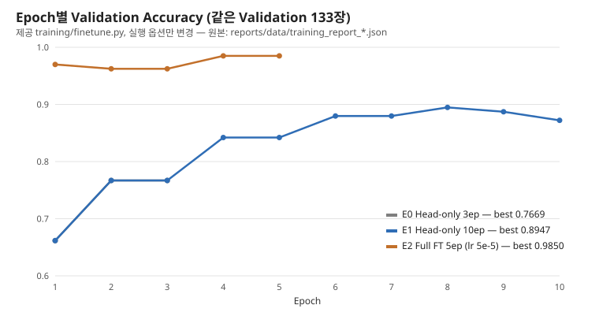

# 산출물 8. 최종 기술보고서 — 콩잎 질병 분류 Vision AI API 서비스

## 1. 프로젝트 정보

| 항목 | 내용 |
|---|---|
| 과제 | KH정보교육원 교과 9 평가 — ResNet-18 기반 Beans 3클래스 분류 및 동기·비동기 서빙 |
| 저장소 | https://github.com/wlgptjd333/kh-subject9-eval-beans |
| 작업일 | 2026-11-04 |
| 입력 | JPG/PNG/WEBP (5MB 이하) |
| 출력 | angular_leaf_spot / bean_rust / healthy |
| 모델 | microsoft/resnet-18 → 최종 선정·서비스 `artifacts/beans_resnet18_full` (E2 Full FT), 기준선 `artifacts/beans_resnet18` (E0 Head-only) |
| 실행구조 | FastAPI·Celery (WSL2 `.venv`) + Redis·PostgreSQL (Docker) |
| 코드 | 평가 자료 01·02 제공 코드 그대로. 추가: `training/evaluate.py`, `scripts/` |

## 2. 모델 학습 결과 요약 — [산출물 1](01_FineTuning_결과보고서.md)

| 항목 | 결과 |
|---|---|
| 학습 방식 | Backbone Freeze / Head-only |
| Train / Validation 수 | 1,034 / 133 (Test 128 보관) |
| Best Validation Accuracy | **0.7669** (Epoch 2), Macro F1 0.764 |
| 가장 약한 클래스 | bean_rust Recall 0.6444 |
| Test 성능 (선정 후 1회) | E0 0.7188 / **최종 E2 0.9766** |
| 모델 파일 | `artifacts/beans_resnet18/model.safetensors` (44.8 MB, Git 제외) |
| 재현성 | 전용 `.venv` 재학습 결과가 이전 학습과 비트 단위로 같음 |

원본 기록: `artifacts/beans_resnet18/training_report.json` → [사본](data/training_report_head_only.json)

## 3. 아키텍처 및 데이터 흐름 — [산출물 2](02_시스템_아키텍처.md)

- 동기: Browser → FastAPI → Redis Cache → (MISS면) ResNet-18 → JSON
- 비동기: Browser → FastAPI → PostgreSQL `queued` → Redis Broker → Celery Worker → (Cache/Model) → PostgreSQL `done` → 상태 조회
- 모델은 FastAPI·Worker 두 프로세스에 각각 로드, 서비스 추론은 CPU

## 4. API·DB 설계 — [산출물 3](03_API_명세서.md) · [산출물 4](04_DB_구조_작업이력.md)

- API: health, 동기 분류(200), 비동기 접수(**202**), 상태 조회(200/404). 오류 400·413·422·404·503 모두 실측
- DB: PostgreSQL `image_jobs` 1개 테이블 (ERD 포함). 16행 — done 14 (MISS 9, HIT 5), failed 2 (파일 유실, Redis 장애)

## 5. 실제 버튼 처리 검증 — [산출물 5](05_AI버튼_처리흐름.md)

- 동기: 분류 완료 후 응답 ([캡처](evidence/ui_sync_miss.png), HIT [캡처](evidence/ui_sync_hit.png))
- 비동기: 202/job_id 수신 후 1초 간격 조회로 완료 확인 ([캡처](evidence/ui_async_done.png))

## 6. 실제 성능 비교 — [산출물 6](06_성능비교_보고서.md)

| 항목 | 중앙값 (5회) |
|---|---:|
| Sync MISS HTTP 완료 | 22.0 ms (추론 17.0 ms) |
| Sync HIT HTTP 완료 | 1.4 ms |
| Async MISS HTTP 접수 | 10.6 ms |
| Async MISS 최종 확인 (0.1초 조회) | 117.8 ms |

- 캐시 HIT로 동기 응답 93.64% 단축 (추론 생략)
- 비동기 접수는 동기 MISS보다 51.82% 빨리 반환 — 접수와 처리 분리 효과이며 **추론 가속은 아님**
- 결과 확인은 비동기가 95.8 ms 늦음 (대부분 조회 간격)

## 7. 기능 테스트·오류 조치 — [산출물 7](07_기능테스트_오류분석.md)

- 실환경 통합 테스트 17개 + 모의 테스트 1개, 모두 PASS (Worker 정지, Redis 장애 503, 작업 실패 failed 포함)
- 오류·조치: 포트 충돌(E-01), 제공 pytest 명령 import 오류(E-02), 데이터 속 `.DS_Store`(E-03), 다른 프로젝트 가상환경 사용(E-04), Test 이미지 시연 사용(E-05), 실행 구조 불일치(E-06) — 모두 조치 후 재검증

## 8. 교과 9 OpenCV 성능 개선 제안 (구현 여부 구분)

**8-1. 실행 옵션만 바꾼 실험 (제공 코드 수정 없음, 실제 실행)** — [산출물 1 §6](01_FineTuning_결과보고서.md)

| 실험 | 구현 | 조건 | Val Accuracy | Test Accuracy | 결론 |
|---|---|---|---:|---:|---|
| E0 Head-only 3 Epoch | 실행 | Validation 133장 | 0.7669 | 0.7188 | 기준선 |
| E1 Head-only 10 Epoch | 실행 | 같은 133장 | 0.8947 | 미사용 (선정 안 됨) | +12.78%p |
| E2 Full Fine-tuning (lr 5e-5) | 실행 | 같은 133장 | **0.985** | **0.9766** | +21.81%p (Val), 최종 선정 |

- 최종 모델은 Validation으로만 골랐고, 선정 기록을 Test 전에 커밋했다 ([model_selection.md](data/model_selection.md))
- E2: 녹병 Recall 0.6444 → 0.9556 (Val), 병든 잎을 정상으로 놓친 경우 11장 → 1장
- 서비스(산출물 2~7)는 E2로 전환해 다시 측정했다 (`MODEL_PATH` 변경 + 재시작, 코드 수정 없음). E0 서비스 기록은 `service_e0/`에 보관

**8-2. CNN + OpenCV 규칙 후처리 (실행)** — [산출물 1 §6-3](01_FineTuning_결과보고서.md)

| 실험 | 구현 | 기준 정한 데이터 | 결과 | 결론 |
|---|---|---|---|---|
| HSV 병반 후보 면적비 (`inRange`·Morphology·Contour) | 실행 (`scripts/review_rule.py`) | Train healthy 95백분위 0.1006 | 병든 잎 중 기준 초과 4.8% | 분리력 부족, 규칙에 넣어도 변화 없음 |
| E2 + "확인 필요" (score < 0.9) | 실행 | Validation (Test 전 커밋 `c16a2b8`) | Test 보류 14.1%, 오류 2/3 잡음, 자동 통과분 0.9909 | 효과 있음. 모델 Accuracy는 그대로 0.9766 |

**8-3. 아직 제안 단계 (미구현)**

| 제안 | 근거 | 처리 흐름 | 검증 방법 | 상태 |
|---|---|---|---|---|
| 잎 ROI·GrabCut 마스크 | 흙 배경이 병반 후보로 잡힘 (§8-2) | 잎 영역만 남긴 입력으로 별도 학습 | 같은 Validation 전후 비교 | 미구현 |
| Grad-CAM | 남은 오류 3장이 모두 녹병 | 중간 특징맵 히트맵 → 병반 위치와 비교 | 오분류 사례 해석 (**정확도를 올리지는 않음**) | 미구현 |
| CNN 점수 + OpenCV 특징 → ML 보조 분류 | angular↔rust 혼동 | 클래스 점수 + HSV 통계 → Logistic Regression | Train 내부 교차검증, 클래스별 F1 | 미구현 |
| `review_required` API 필드 | §8-2 규칙 | 응답에 확장 필드 추가 (라벨 유지) | API 테스트 | 미구현 (제공 API 그대로 유지) |

모델 자체 성능과 후처리된 시스템 성능은 따로 보고한다. Test는 방법·임계값 선택에 쓰지 않는다.

## 9. 최종 판정 및 한계

- 필수 기능: 학습 → 동기 서빙 → 비동기 큐 → 캐시 HIT/MISS → DB 기록 → 측정까지 평가 가이드 구조에서 실제로 실행하고 증빙을 남김
- 모델 분류 품질: 필수 E0 Test 0.7188 → 실행 옵션만 바꾼 Full Fine-tuning E2 Test **0.9766** (25.78%p). 남은 오류는 녹병 3장
- 한계: 실험마다 학습 1회, Test 128장은 작은 표본, 거의 같은 사진 중복 미점검, 성능 측정은 단일 PC·CPU·5회·순차 요청
- 추후 과제: seed를 바꾼 반복 학습으로 편차 확인
